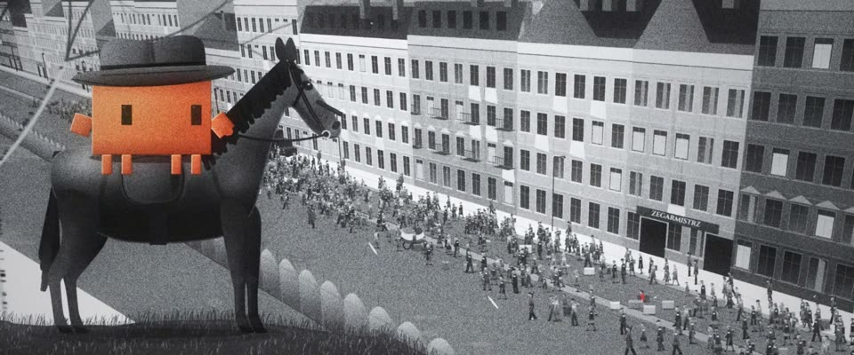

# 黑白胶片 · 唯一的红大衣 · Black-and-white Film, One Red Coat

> 原文：lemo-opuscar `styleboard/opuscar98_styles.json` 第 66 条（OPUSCAR 98 纪念片里《辛德勒的名单》Schindler's List（1993）那一段的风格；LemoLab，MIT，commit `f171360`），2026-10-31 收入本仓库作参考（不在风格库里，片子不能选它当风格），未改动。
> 这是约 5 秒片段的风格，没有完整的十一节说明，所以不进风格库。用法：当视觉语言的参考——某一段画面想要这种质感时，借它的提示词写进决策单，声音、镜头、坑由模型自己补。

**渲染**：2D（2D·B&W）　**手法组合**：高反差黑白胶片 · 粗颗粒银盐 · 局部留色 · Janusz Kamiński（High-contrast B&W film · Coarse silver grain · Selective colour · Janusz Kamiński）

## 风格提示词（中文原文）

黑白电影质感：冷中性灰，强 S 曲线（黑接近 #111，白接近 #EEE），高光在雾里泛光晕，略软的老镜头，逐帧变化的银盐颗粒（±6%），轻微闪烁，偶有灰尘，暗角。全画面是灰的，只有故事围绕的那个主角是饱和色，以衣服为主（如陶土橙 #D97757）；可再有一个红色故事道具（#A3241F–#C9463C）。灯和火保持灰色，除非“火苗先灰后转暖”是剧情节点。长焦压缩空间，前景虚焦树枝；有人群时，体型、衣色和步态人人不同。默认阴天中间调，暗部不死黑。招牌镜头：长焦俯看许多走动的小人，带色的那个在其中；没有人群就让主角很小地落在大片灰里。对标摄影师 Janusz Kamiński（《辛德勒的名单》，1993）。避免：棕褐或偏蓝调色；无颗粒的干净灰；超过两样有颜色的东西。

## Style prompt (English original)

Black-and-white film look: cold neutral greys, a strong S-curve (blacks near #111, whites near #EEE), highlights haloing in haze, a soft old lens, silver grain re-rolled every frame (±6%), slight flicker, rare dust, vignette. Everything is grey except the one hero the story centres on, saturated, mainly clothing (e.g. terracotta #D97757); optionally one red story object (#A3241F–#C9463C). Lamps and fires stay grey, unless a flame turning from grey to warm is the story beat. Long-lens compression, soft foreground branches; in a crowd, no two people alike in build, tone or gait. Default: overcast mid-key, shadows open. Signature shot: high long-lens view of many small walking figures, the coloured one among them; without a crowd, the hero tiny in wide grey space. Reference: cinematographer Janusz Kamiński (*Schindler's List*, 1993). Avoid: sepia or blue toning; grain-free greys; more than two coloured things.

## 这个风格是什么（上游说明）

冷灰、高反差的黑白，粗颗粒，高光晕开；只有小女孩的红大衣和 Clawd 的橙色有颜色。这正是斯皮尔伯格的手法：红大衣和安息日烛火是全片仅有的彩色。

Cold, high-contrast black and white with coarse grain and haloed highlights, where only the girl's red coat and Clawd's orange keep their colour. It follows Spielberg's own device: the red coat and the Sabbath candle flames are the film's only colour.

## 上游示范用法（只是一个例子，不要照搬故事和镜头）

Clawd 扮辛德勒：灰色软呢帽、手握缰绳，坐在马上往下看。四个硬切跟着他的目光走：山坡、长焦主观镜头、街面，最后收在蜡烛上，每个镜头约一拍半。全程克制：人只是在走，不出现任何暴力。

| 机位 | 镜头 | Shot |
|---|---|---|
| hill | 山坡上骑着深色马的 Clawd（辛德勒），坡下的街道挤满被驱赶的人群，人群里有一个红点；镜头轻推。 | Clawd as Schindler on a dark horse on the hilltop, the ghetto street below packed with people being driven along it, one red dot among them; a slight push-in. |
| pov | 硬切到辛德勒的长焦主观镜头，跟住独自走在人群空当里的红大衣小女孩。 | Hard cut to Schindler's point of view through a long lens, following the girl in the red coat as she walks alone through a gap in the crowd. |
| street | 硬切到街面：横移镜头和小女孩同速，三排人从店铺前往左走，一件虚焦的大衣从镜头前掠过。 | Hard cut down to street level: a lateral track keeps pace with the girl as three rows of people walk left past the shopfronts, a blurred coat crossing the lens. |
| candles | 硬切到黑暗里的两支安息日蜡烛：火苗先亮成灰白，再变成彩色；缓慢推进。Clawd 不在画面里。 | Hard cut to two Sabbath candles in the dark: the flames come up grey, then turn to colour; a slow push-in. Clawd is not in the shot. |

参考：Steven Spielberg, Schindler's List (1993)；Janusz Kamiński (cinematography)；Schindler's List (1993) poster

