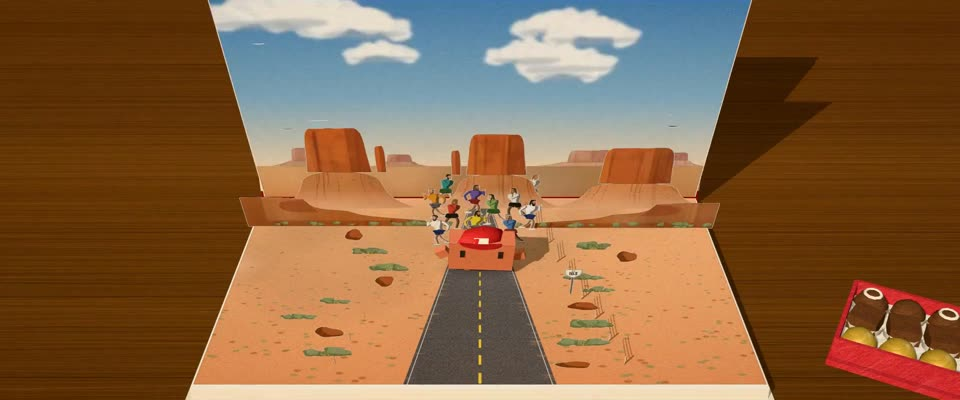

# 立体书 · 真实书桌上的纸艺 · Sabuda Pop-up Book on a Real Desk

> 原文：lemo-opuscar `styleboard/opuscar98_styles.json` 第 67 条（OPUSCAR 98 纪念片里《阿甘正传》Forrest Gump（1994）那一段的风格；LemoLab，MIT，commit `413a6bd`），2026-10-27 收入本仓库作参考（不在风格库里，片子不能选它当风格），未改动。
> 这是约 5 秒片段的风格，没有完整的十一节说明，所以不进风格库。用法：当视觉语言的参考——某一段画面想要这种质感时，借它的提示词写进决策单，声音、镜头、坑由模型自己补。

**渲染**：2.5D（2.5D）　**手法组合**：Robert Sabuda 立体书结构 · 水彩、彩铅印刷质感 · three.js 纸卡 · 物理景深（Robert Sabuda pop-up engineering · Watercolour and coloured-pencil print · three.js paper cards · Physical depth of field）

## 风格提示词（中文原文）

一本放在书桌上实拍的立体书。每个元素是平的模切卡片，靠平行折立在打开成 90° 的背景页前，印着透明水彩和带纸纹的彩铅排线，切口露出白纸芯和灰纸板边。默认光：左上方窗户进来的明亮日光，层间柔和投影。卡面（天蓝、暖沙、绿）和房间都保持日光，故事在任何时段都一样；时段只画在印刷画面里（如低太阳、夜空）。胡桃木书桌 #6B3E1E，后面的房间虚成暖色柔光。物理景深，焦点在主角那层。招牌镜头：高机位四分之三角度看整个跨页。一个连续镜头：钻进一页、拉远到整本书、翻页代替剪辑、再推进下一跨页。对标 Robert Sabuda、Matthew Reinhart 的立体书。避免：像实心模型的卡片；昏暗压抑的房间；卡通脸。

## Style prompt (English original)

A real pop-up book filmed on a desk. Every element: a flat die-cut card on parallel folds before a 90° backdrop page, printed with transparent watercolour and grainy coloured-pencil hatching; cut edges show a white core and grey board. Default light: bright window daylight from the upper left, soft shadows between layers. Print colours (sky blue, warm sand, greens) and room light stay daylight whatever the story's time of day; that time appears only in the print (e.g. a low sun, a night sky). Walnut desk #6B3E1E; the room a warm blur. Physical depth of field, focus on the hero's layer. Signature shot: a high three-quarter view of the whole spread. One continuous move: dive into a page, pull back, turn the page instead of cutting, push into the next spread. References: Robert Sabuda, Matthew Reinhart. Avoid: solid-looking cards; dark moody rooms; cartoon faces.

## 这个风格是什么（上游说明）

平行折立起来的印刷卡片，白色纸芯、灰色纸板边、层与层之间的投影和浅景深，放在胡桃木书桌上。阿甘坐在长椅上把一生讲成故事，翻开一页就立起一段经历。

Printed cards standing up in parallel folds, with white cores, grey board edges, layered shadows and shallow focus, on a walnut desk. Forrest tells his life on a bench, so each page that pops up is one chapter.

## 上游示范用法（只是一个例子，不要照搬故事和镜头）

Clawd 扮阿甘：长椅上捧着一盒巧克力，公路和船上戴红色棒球帽。12 拍一个镜头不切：羽毛把镜头带进书里，两次翻页（约 2.7 秒和 4.2 秒）代替剪辑。3.25 秒开始跑，紧接着停下、转身。

| 机位 | 镜头 | Shot |
|---|---|---|
| one | 一镜到底：书桌上合着的书翻开，萨凡纳的广场立起来；镜头跟着一根飘落的白羽毛降到长椅，Clawd 把巧克力递给护士；拉远、翻页，推进到纪念碑谷的 US-163，戴红帽的 Clawd 领着一群胡子拉碴的跟跑者跑近、停下、转身面对他们；再拉远、翻页，推进到闪电交加的暴风雨里的捕虾船「珍妮号」。 | One continuous shot: the closed book on the desk opens and Savannah's square pops up; the camera drops in with a falling white feather to the bench, where Clawd offers the nurse a chocolate; it pulls back, the page turns, and it pushes in to US-163 in Monument Valley, where Clawd in a red cap runs in ahead of the bearded followers, stops and turns to them; it pulls back again, the page turns, and it pushes in to the shrimp boat Jenny in a lightning storm. |

参考：Robert Zemeckis, Forrest Gump (1994)；Don Burgess (cinematography)；Forrest Gump (1994) poster；Robert Sabuda & Matthew Reinhart

