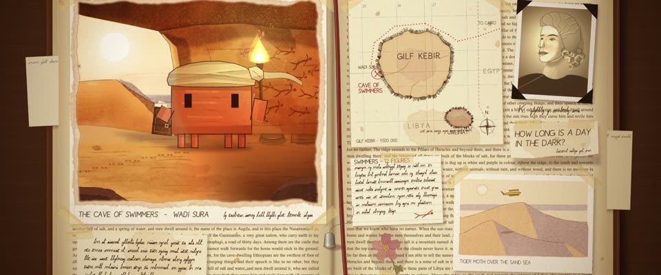

# 探险家剪贴本水彩 · Explorer's Scrapbook Watercolour

> 原文：lemo-opuscar `styleboard/opuscar98_styles.json` 第 69 条（OPUSCAR 98 纪念片里《英国病人》The English Patient（1996）那一段的风格；LemoLab，MIT，commit `f171360`），2026-10-31 收入本仓库作参考（不在风格库里，片子不能选它当风格），未改动。
> 这是约 5 秒片段的风格，没有完整的十一节说明，所以不进风格库。用法：当视觉语言的参考——某一段画面想要这种质感时，借它的提示词写进决策单，声音、镜头、坑由模型自己补。

**渲染**：2D（2D）　**手法组合**：透明水彩 · 钢笔笔记和手写 · 剪贴拼贴：胶带、照片、地图 · 琥珀褐调色（Transparent watercolour · Pen notes and handwriting · Scrapbook collage: tape, photos, maps · Amber-sepia grade）

## 风格提示词（中文原文）

旅人的剪贴本铺满画面，从边到边挤满 6–10 样互相压叠的东西，有的伸出画框：胶带贴的水彩画（主画面，约占四成）、手绘地图、深褐老照片、印刷页、手写便条、压花；每样带柔影和泛黄胶带。水彩画：湿中湿铺色，受光面暖赭，暗面是硬边紫玫瑰色，钢笔勾轮廓，积色边，明暗对比清楚。配色：琥珀纸 #E8D6B0、深褐 #6B4A2E、赭 #D08A3C、紫玫瑰 #9C6A86、墨 #2A1E16。画里：暗前景里一个暖光源（火把、灯）投下光池，外面是明亮的天。琥珀调色只轻压书页，画里保持干净不发脏；暗角约两成，纸纹淡。招牌动作：推进一张画，直到书页边缘从两侧滑出、人已在画里。对标摄影师 John Seale（《英国病人》，1996）。避免：平滑数码渐变；稀疏整齐的版面；书页还框着画时横摇。

## Style prompt (English original)

A traveller's scrapbook, crowded edge to edge with 6–10 overlapping items, some running off frame: a taped watercolour (the main image, about 40% of frame), a hand-drawn map, a sepia photo, printed pages, handwritten notes, a pressed flower; each softly shadowed, with yellowed tape. The watercolour: wet-in-wet washes, warm ochre lights, hard-edged violet-rose shadows, pen contours, pooled edges, clear value contrast. Palette: amber paper #E8D6B0, sepia #6B4A2E, ochre #D08A3C, rose-violet #9C6A86, ink #2A1E16. Inside the painting: one warm source (torch, lamp) pooling in a dark foreground, bright sky beyond. Light amber grade on the page only, never muddying the painting; vignette about 20%, faint grain. Signature move: push into the painting until the page edges slide out. Reference: cinematographer John Seale (*The English Patient*, 1996). Avoid: smooth gradients; sparse tidy layouts; panning while a page frames the painting.

## 这个风格是什么（上游说明）

贴在旧书里的水彩速写，夹着地图、照片、便条和压花，整体是海报的琥珀褐。艾玛殊那本塞满画和笔记的希罗多德是全片的框架，镜头就穿过一张水彩进入游泳者洞穴。

Watercolour sketches taped into an old book among maps, photos, notes and pressed flowers, in the poster's amber-sepia. Almásy's Herodotus, stuffed with his paintings and notes, frames the film, so the camera pushes through one painting into the Cave of Swimmers.

## 上游示范用法（只是一个例子，不要照搬故事和镜头）

Clawd 扮艾玛殊：亚麻沙漠头巾，巾尾飘着，一手希罗多德、一手火把。推进画里的镜头本身就是转场；之后两个硬切都留在洞里，先壁画，再 Clawd。场景时间约为屏幕时间的 1.8 倍。

| 机位 | 镜头 | Shot |
|---|---|---|
| push | 剪贴本摊在桌上，一个推镜推进那张水彩，直到书页从镜头两侧滑出：Clawd 举着火把站在画里的游泳者洞穴中。 | The scrapbook open on the desk, then one push into the watercolour page until it slides past the lens: Clawd stands in the painted Cave of Swimmers with a torch. |
| wall | 硬切到横移，扫过洞壁上的游泳人壁画，火光摇晃；Clawd 不在画面里。 | Hard cut to a lateral drift across the swimmer paintings on the cave wall in flickering torchlight; Clawd is off-screen. |
| cave | 硬切到 Clawd 一手火把一手书站在左边，旁边是壁画，洞口外是沙丘；镜头缓慢后移。 | Hard cut to Clawd with torch and book on the left, the painted wall beside it and the dunes beyond the cave mouth; a slow drift back. |

参考：Anthony Minghella, The English Patient (1996)；John Seale (cinematography)；The English Patient (1996) poster；Cave of Swimmers, Wadi Sura

