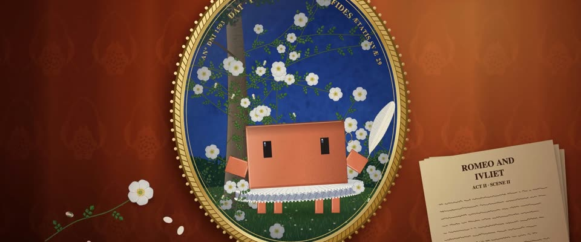

# 希利亚德伊丽莎白细密画 · Hilliard Elizabethan Miniature

> 原文：lemo-opuscar `styleboard/opuscar98_styles.json` 第 71 条（OPUSCAR 98 纪念片里《莎翁情史》Shakespeare in Love（1998）那一段的风格；LemoLab，MIT，commit `413a6bd`），2026-10-27 收入本仓库作参考（不在风格库里，片子不能选它当风格），未改动。
> 这是约 5 秒片段的风格，没有完整的十一节说明，所以不进风格库。用法：当视觉语言的参考——某一段画面想要这种质感时，借它的提示词写进决策单，声音、镜头、坑由模型自己补。

**渲染**：2D（2D）　**手法组合**：宫廷细密肖像（limning） · 羊皮纸上的不透明水彩 · 贝壳金 · 深红锦缎静物（Portrait miniature (limning) · Body colour on vellum · Shell gold · Crimson damask still life）

## 风格提示词（中文原文）

伊丽莎白时代宫廷细密画，学尼古拉斯·希利亚德：暖色羊皮纸上平涂不透明水彩，暗面极细排线（线宽约画面宽度的 1/1000），受光边点铅白，红褐轮廓线。配色：群青底 #203E92、贝壳金 #D6B05C（细颗粒金点加几处抛光高光）、胭脂红 #A8202C、铅白 #F6F2E8、铜绿 #346C40。招牌画面：主体画在金边椭圆挂坠里，挂坠平放在锈红色锦缎上；一丛开满白花的野蔷薇铺满主体身后和四周，上沿一圈金色罗马大写短铭文。椭圆底色始终是群青，风景和天空放进去时画成平涂色带。大场景可离开挂坠，画法不变。镜头慢推、轻微下摇，只有花、布料和手势在动。对标希利亚德《玫瑰丛中的青年》（约 1587）。避免：喷枪渐变；厚油画笔触；平黄色的金。

## Style prompt (English original)

Elizabethan portrait miniature in Nicholas Hilliard's manner: opaque watercolour laid flat on warm vellum, very fine hatching in shadows (lines about 1/1000 of frame width), lead-white dots on lit edges, red-brown outlines. Palette: ultramarine ground #203E92, shell gold #D6B05C (granular flecks, a few burnished highlights), carmine #A8202C, lead white #F6F2E8, verdigris #346C40. Signature shot: the picture inside a gold-rimmed oval locket lying on rust-red damask; a flowering white eglantine briar fills the oval behind and around the subject; a short motto in gold Roman capitals arcs along the top. The oval's ground stays ultramarine; landscape and sky go in as flat colour bands. Wide scenes may leave the locket, same method, true perspective. Slow push, slight tilt; only flowers, cloth and gestures move. Reference: Hilliard, *Young Man Among Roses* (c. 1587). Avoid: airbrush gradients; thick oil strokes; flat yellow gold.

## 这个风格是什么（上游说明）

学尼古拉斯·希利亚德的伊丽莎白时代宫廷细密画：羊皮纸上的不透明水彩、群青底、贝壳金题字、白色野蔷薇。影片发生在莎士比亚的伦敦，细密画正是那个宫廷自己的肖像形式。

An Elizabethan portrait miniature in Nicholas Hilliard's manner: body colour on vellum, an ultramarine ground, shell-gold lettering, white eglantine. The film is set in Shakespeare's London, and the miniature was that court's own form of portrait.

## 上游示范用法（只是一个例子，不要照搬故事和镜头）

Clawd 扮莎士比亚：浆硬的轮状皱领、金耳环，细密画里拿羽毛笔，舞台上换成白玫瑰。四个镜头硬切，从私人的细密画一路走到公众的剧院，最后一拍女王慢慢点头，收住这一段。

| 机位 | 镜头 | Shot |
|---|---|---|
| miniature | 近景：深红锦缎上的金色挂坠细密画，Clawd 扮莎士比亚站在白色野蔷薇里，戴轮状皱领，羽毛笔在写字；镜头慢慢推近，略往下摇。 | Close on the gold locket lying on crimson damask: Clawd as Will stands among white eglantine in a ruff, the quill wiggling as it writes; a slow push in with a slight tilt down. |
| stage | 全景：玫瑰剧院。镜头从上方的彩绘天幕和看台往下摇并推近到舞台，Clawd 拿着一朵白玫瑰站在台上，女王坐在右侧包厢里。 | Wide of the Rose playhouse: the camera starts tilted up on the painted heavens and galleries, then tilts down and pushes in to the stage, where Clawd holds a white rose and the Queen sits in her box at right. |
| balcony | 中景：阳台戏，朱丽叶在上方托腮，Clawd 在下面向她举起白玫瑰；镜头略推。 | Medium shot of the balcony scene: Juliet above leans her cheek on her hand while Clawd below raises the white rose to her; a slight push in. |
| queen | 近景：华盖下包厢里的伊丽莎白女王，从看戏转过脸来，摇着扇子，慢慢点头；镜头略推。 | Close on Queen Elizabeth in her box under the cloth of estate: she turns from the stage, fans herself and gives a slow nod; a slight push in. |

参考：John Madden, 1998；Nicholas Hilliard, Young Man Among Roses (c.1587)；Shakespeare in Love 1998 poster (red damask, amber light)

