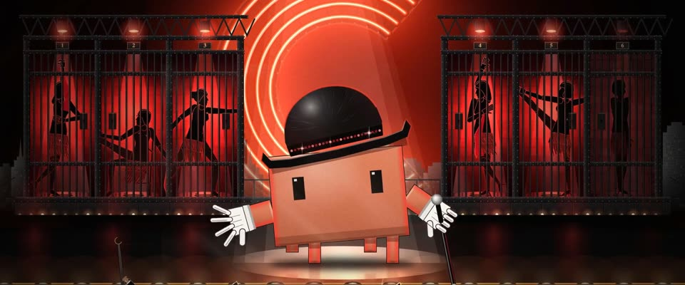

# 福斯舞台：红黑聚光剪影 · Fosse Stage in Red and Black

> 原文：lemo-opuscar `styleboard/opuscar98_styles.json` 第 75 条（OPUSCAR 98 纪念片里《芝加哥》Chicago（2002）那一段的风格；LemoLab，MIT，commit `f171360`），2026-10-31 收入本仓库作参考（不在风格库里，片子不能选它当风格），未改动。
> 这是约 5 秒片段的风格，没有完整的十一节说明，所以不进风格库。用法：当视觉语言的参考——某一段画面想要这种质感时，借它的提示词写进决策单，声音、镜头、坑由模型自己补。

**渲染**：2D（2D）　**手法组合**：鲍勃·福斯的舞台调度 · 勾红边的逆光剪影 · 霓虹与亮片 · 2002 年海报的红黑（Bob Fosse staging · Red-rimmed backlit silhouettes · Neon and sequins · Chicago 2002 poster colours）

## 风格提示词（中文原文）

鲍勃·福斯式百老汇歌舞舞台。黑底，但约四成画面发信号红 #D0202A：一排带栏杆的暗色格间，每格在烟雾里从背后打红光，中心最亮、向四周暗到黑，再加红幕；硬边聚光穿过烟雾。舞者是实心黑剪影，身形饱满、有服装轮廓，外面一圈 2–3px 红色边光。一个大霓虹字形（字母或图形），橙红 #FF5A3C，白热芯、微闪，要放在黑底上才读得出；黑色亮漆地板倒映它；台边一排跑马灯泡 #FFD9A0。主角站在暖白追光 #FFF1D6 里，是唯一被照亮、保留自身颜色的人。点缀：亮片、白手套。动作踩爵士拍子；灯格一间间啪地亮。镜头推进，收在追光里。对标 Rob Marshall《芝加哥》（2002）。避免：平涂匀光；多余颜色；剪影没有边光。

## Style prompt (English original)

Bob Fosse-style Broadway stage number. Black stage, but about 40% of the frame glows signal red #D0202A: a row of dark barred cells, each backlit red through haze, bright at centre, falling off to black, plus red curtains; hard-edged spots. Dancers are full-bodied black silhouettes with costume shapes and a 2–3 px red rim. One big neon shape (letter or pictogram) in orange-red #FF5A3C, white-hot core, slight flicker, set against black so it reads; glossy black floor reflects it; marquee bulbs #FFD9A0 at the stage edge. The hero, in a warm-white follow spot #FFF1D6, is the only lit figure in its own colours. Accents: sequins, white gloves. Moves on the jazz beat; cells snap on one by one. Push in to end in the follow spot. Reference: Rob Marshall, *Chicago* (2002). Avoid: flat even fills; extra colours; rimless silhouettes.

## 这个风格是什么（上游说明）

黑色舞台被硬边聚光切开：六间牢房里是勾红边的女囚剪影，背后霓虹 C，亮片和烟雾，Clawd 在白色追光里。这是电影版的「Cell Block Tango」，用海报的红黑。

A black stage cut by hard spotlights: six cells with women in red-rimmed silhouette, a neon C, sequins, haze, and Clawd in a white follow spot. It is the 'Cell Block Tango' number from Rob Marshall's film, in the poster's red and black.

## 上游示范用法（只是一个例子，不要照搬故事和镜头）

Clawd 戴福斯式圆顶礼帽（帽带一圈亮片）、白手套，拿黑手杖。第一个镜头里牢房跟着拍子一间间亮；快切一个女囚；然后 Clawd 独占追光，以 jazz hands 收尾。表演按真实速度走，不加速。

| 机位 | 镜头 | Shot |
|---|---|---|
| stage | 舞台全景，霓虹 C 在后面：六间牢房一间间亮起，每个女囚啪地摆出招牌姿势，Clawd 在台中央走福斯步；镜头慢推。 | Wide of the whole stage with the neon C behind: the six cells light one by one, each woman snapping into her pose, while Clawd struts centre stage; a slow push in. |
| cell4 | 近景：一间牢房，铁栏后红光里 Velma 的剪影，扭胯、耸肩；镜头略推。没有 Clawd。 | Close on one cell: Velma's silhouette behind the bars in red light, a hip roll and a shrug; a slight push in. No Clawd. |
| spot | 中近景：Clawd 独自站在白色追光里，身后是亮着的牢房：它走福斯步到脚灯前，然后放下手杖，双手 jazz hands 举起；镜头慢推。 | Medium close of Clawd alone in the white follow spot, the lit cells behind: it struts down toward the footlights, then the cane is gone and both jazz hands go up; a slow push in. |

参考：Rob Marshall, 2002；Dion Beebe (cinematography)；Bob Fosse, Chicago (1975 stage)；Chicago 2002 poster

