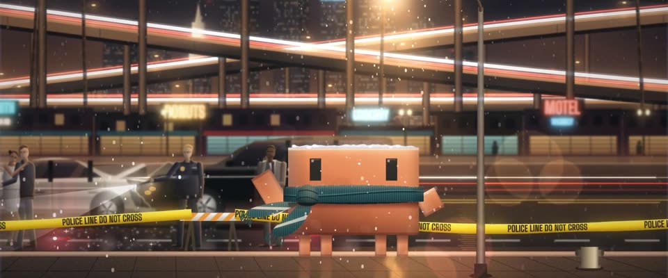

# 洛杉矶夜景光轨 + 飘雪 · LA Night Light Trails & Snow

> 原文：lemo-opuscar `styleboard/opuscar98_styles.json` 第 78 条（OPUSCAR 98 纪念片里《撞车》Crash（2005）那一段的风格；LemoLab，MIT，commit `413a6bd`），2026-10-27 收入本仓库作参考（不在风格库里，片子不能选它当风格），未改动。
> 这是约 5 秒片段的风格，没有完整的十一节说明，所以不进风格库。用法：当视觉语言的参考——某一段画面想要这种质感时，借它的提示词写进决策单，声音、镜头、坑由模型自己补。

**渲染**：2D（2D）　**手法组合**：长曝光夜景摄影 · 钠灯橙配霓虹青 · 变形宽银幕光条与胶片颗粒（Long-exposure night photography · Sodium orange and neon cyan · Anamorphic bloom and film grain）

## 风格提示词（中文原文）

长曝光夜景街拍。钠灯暖橙 #F2A24A 铺满建筑、招牌和湿地面（约一半画面在暖光里），对着青色霓虹 #3FD0D8，偶有红蓝警灯；黑色略偏青，不能发灰。构图分层：前景人行道有人，中景亮着的店面招牌，上三分之一横过道路或桥（不在城市就用主体所在地一条有路灯的路）。车灯沿这些路拉成细而连续的光带（约画宽 1/150），白 #FFF4E0 与红 #E0303A，带光晕和发烫的芯。雪分三层，短而柔的拖影，只在光锥里可见。收尾：两级泛光、蓝色横向光条、边缘焦外光斑、暗角、动态颗粒。主角清楚地站在画面中部一盏灯的光锥里，只有车流拖影。镜头：一个连续运镜，俯仰、横摇加转焦。对标摄影师 J. Michael Muro（《撞车》，2004）。避免：雪到处一样亮；大片空黑；光带断成点。

## Style prompt (English original)

Long-exposure night street photography. Sodium-vapour orange #F2A24A washes structures, signs and wet ground (about half the frame in warm light), against cyan neon #3FD0D8 and the odd red-blue emergency light; blacks cyan-tinged, never grey. Layered composition: foreground pavement with figures, lit shopfronts and signs mid-frame, roads or bridges crossing the upper third (away from cities, a lamp-lit road in the subject's own setting). Headlights become thin continuous ribbons (about 1/150 of frame width) along those roads, white #FFF4E0 and red #E0303A, glowing with hot cores. Snow: three layers of short soft streaks, seen only in light cones. Finish: two-level bloom, blue lens streaks, edge bokeh, vignette, moving grain. The hero stands sharp in a lamp cone mid-frame; only traffic streaks. Camera: one continuous tilt, pan and rack focus. Reference: cinematographer J. Michael Muro (*Crash*, 2004). Avoid: evenly lit snow; empty black frames; dotted trails.

## 这个风格是什么（上游说明）

用代码画的精修夜景照片：高架上白色和红色的车灯光轨、钠灯橙对霓虹青、湿路面反光、焦外光斑，还有只在光里才看得见的雪。《撞车》的结尾正是洛杉矶难得的一场雪。

A polished night photograph made in code: freeway light trails in white and red, sodium orange against neon cyan, wet asphalt, bokeh, and snow that shows only where light hits it. Crash ends on a rare snowfall over Los Angeles.

## 上游示范用法（只是一个例子，不要照搬故事和镜头）

Clawd 围一条手织的深青色围巾，站在路灯下仰头看雪。一个连续运镜从光轨到车祸再到 Clawd，快速移动的几段带运动模糊。镜头到它那里时雪变大，接雪的动作落在快结束的地方。

| 机位 | 镜头 | Shot |
|---|---|---|
| oner | 一镜到底：开场仰拍立交桥上的光轨，往下摇到警戒带后的追尾现场，焦点在事故上；再沿着路缘往右摇到钠灯下的 Clawd，焦点拉过来；Clawd 抬起手臂接一片雪，眨了下眼。 | One continuous move: it opens tilted up on the interchange light trails, tilts down onto the rear-end crash behind the police tape with focus on the wreck, then pans right along the kerb to Clawd under the sodium lamp as focus pulls to it; Clawd raises an arm to catch a snowflake and blinks. |

参考：Paul Haggis, 2004；J. Michael Muro (cinematography)；Crash 2005 poster；Four Level Interchange long-exposure photography

