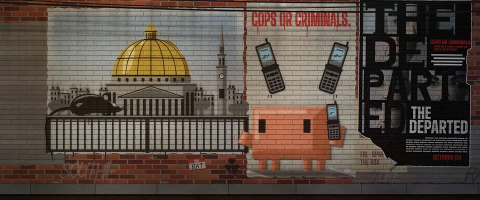

# 波士顿红砖墙模板涂鸦 · Street Stencil on Boston Brick

> 原文：lemo-opuscar `styleboard/opuscar98_styles.json` 第 79 条（OPUSCAR 98 纪念片里《无间行者》The Departed（2006）那一段的风格；LemoLab，MIT，commit `413a6bd`），2026-10-27 收入本仓库作参考（不在风格库里，片子不能选它当风格），未改动。
> 这是约 5 秒片段的风格，没有完整的十一节说明，所以不进风格库。用法：当视觉语言的参考——某一段画面想要这种质感时，借它的提示词写进决策单，声音、镜头、坑由模型自己补。

**渲染**：2D（2D）　**手法组合**：多层喷漆模板 · 班克斯的老鼠 · 红砖墙肌理 · 半调糊贴海报（Multi-layer spray stencil · Banksy's rats · Red-brick wall texture · Halftone paste-up poster）

## 风格提示词（中文原文）

老红砖墙上的街头模板涂鸦。每件作品用 3–5 块镂空模板喷成平色块，有照片感（最小镂空约画宽 1/200）：硬切口，模板翘起处有柔喷雾，散落喷点，流挂，以及模板必须留的连接筋。配色：黑 #151312、中灰 #8C8A85、金 #C99A2E、红 #C3261F；红砖 #7A3224，主要作品喷在刷上去的奶油色补丁上。砖面凹凸、灰缝阴影和雨痕透过漆显出来，让漆吃进砖缝。一面墙并排放好几件作品，加关于题材的手喷短标语（用观众的语言）、旧 tag 和一张撕角的半调糊贴海报。光：柔和的白天光斜扫过墙，反差适中，电线影子轻轻晃；不加重暗角。镜头：先让作品一层层喷出来，再切近景、横移。对标班克斯。避免：边缘干净像矢量；漆浮在砖上；颜色太多；墙面昏暗。

## Style prompt (English original)

Street stencil graffiti on an old red-brick wall. Each piece is 3–5 stencils sprayed as flat colour, photo-derived in look (smallest cut detail about 1/200 of frame width): hard cut edges, soft overspray where a stencil lifted, spray dots, drips, stencil bridges. Palette: black #151312, mid grey #8C8A85, gold #C99A2E, red #C3261F; brick #7A3224, cream painted patches under the main pieces. Brick relief, mortar and rain streaks show through, so paint sinks into the joints. A busy wall: several pieces side by side, short hand-sprayed slogans about the subject (user's language), old tags, a torn halftone paste-up. Light: soft raking daylight, mild contrast, a faint swaying wire shadow; no heavy vignette. Camera: pieces spray on layer by layer, then close-ups and lateral tracks. Reference: Banksy. Avoid: clean vector edges; paint floating on the brick; too many colours; a dark wall.

## 这个风格是什么（上游说明）

平涂的多层喷漆模板，有喷雾毛边和流挂，漆吃进砖缝，旁边一张撕破的糊贴海报。《无间行者》最后一个镜头是老鼠爬过州议会金顶下的栏杆，街头模板涂鸦也一直爱画老鼠。

Flat spray-paint stencil layers with overspray and drips, the paint sinking into brick mortar, beside a torn paste-up poster. The Departed ends on a rat crossing a railing below the State House dome, and street stencils have their own tradition of rats.

## 上游示范用法（只是一个例子，不要照搬故事和镜头）

Clawd 扮卧底警察，耳边贴着翻盖手机，本身也是墙上喷出来的一层。前两拍作品一层层喷出来，之后手机、老鼠、Clawd 挂电话，快切接连出现。没人说话，靠铃声和老鼠讲完。

| 机位 | 镜头 | Shot |
|---|---|---|
| wall | 全景：整面墙，模板画一层层喷出来：城市、金顶、栏杆、老鼠、拿手机的 Clawd、红色标语；镜头略推。 | Wide of the whole wall: the stencil sprays itself on layer by layer (city, gold dome, railing, rat, Clawd with the phone, red tagline); a slight push in. |
| phone | 近景：两部喷漆翻盖手机隔空响铃，Clawd 耳边也贴着手机；它听着，眼睛往左瞟；镜头慢慢往右漂。 | Close on the two sprayed flip phones ringing across the gap, with Clawd's own phone at its head; Clawd listens, eyes sliding left; a slow drift right. |
| rat | 中景：老鼠沿着金顶下的栏杆跑过，左上角喷着「WHO'S THE RAT?」，警灯的红蓝光扫过砖墙；镜头跟着往右横移。 | Medium shot of the rat scurrying along the railing under the gold dome, 'WHO'S THE RAT?' sprayed at upper left, a siren washing the brick; the camera tracks right with it. |
| close | 近景：Clawd 把手机往下一放，眼睛看向右边；镜头略推。 | Close on Clawd: it snaps the phone down and looks right; a slight push in. |

参考：Martin Scorsese, 2006 (the final shot)；Michael Ballhaus (cinematography)；The Departed 2006 poster；Banksy

