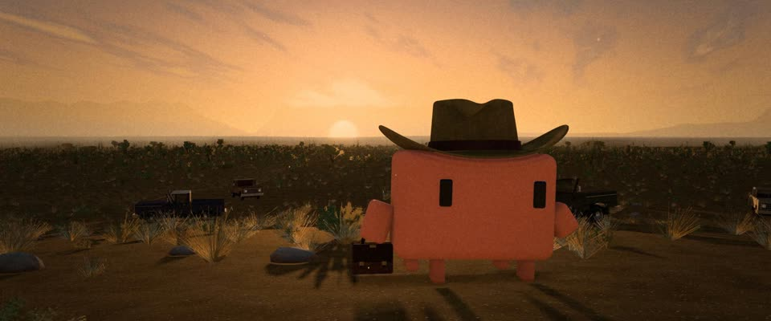

# 3D 西德州荒原黄昏（迪金斯光） · 3D West Texas Dusk, Deakins Light

> 原文：lemo-opuscar `styleboard/opuscar98_styles.json` 第 80 条（OPUSCAR 98 纪念片里《老无所依》No Country for Old Men（2007）那一段的风格；LemoLab，MIT，commit `f171360`），2026-10-31 收入本仓库作参考（不在风格库里，片子不能选它当风格），未改动。
> 这是约 5 秒片段的风格，没有完整的十一节说明，所以不进风格库。用法：当视觉语言的参考——某一段画面想要这种质感时，借它的提示词写进决策单，声音、镜头、坑由模型自己补。

**渲染**：3D（3D）　**手法组合**：实时 3D（three.js） · 罗杰·迪金斯的黄昏光 · 低饱和胶片调色（Real-time 3D (three.js) · Roger Deakins dusk light · Desaturated film grade）

## 风格提示词（中文原文）

偏写实的 3D 黄昏旷野（three.js）。天空很大，约占画面六成，地平线处尘土赭色 #D8A060，往上渐到淡奶油色，几缕细长云被下方照亮。太阳高出地平线 1–2°，仍能投影，光沿远处坡脊烧成一线亮边。低饱和：成百丛灰绿小灌木退向地平线，碎石和干草散在暗暖色泥土 #2A2622 上（默认干旱荒地，换别的地貌也保留稀疏成丛的植被）。主角逆光站在中景，约占画面高度三分之一，长影子朝镜头拉来。按天空曝光：太阳可以过曝，光晕不超过画面十分之一。调色：中性色调映射、暖高光、细颗粒、暗角。招牌镜头：基本固定，低机位广角（约 35mm）。对标摄影师 Roger Deakins（《老无所依》，2007）。避免：饱和的橙色晚霞；大片发白眩光；光秃的地面；忙乱的运镜。

## Style prompt (English original)

Photoreal-leaning 3D landscape at dusk. Sky fills 60% of the frame, dusty ochre #D8A060 at the horizon up to pale cream, thin streaked clouds lit from below. Sun 1–2° above the horizon, still casting shadows; its light burns along the far ridge. Low saturation: hundreds of grey-green scrub clumps receding to the horizon, stones, dry grass, dark warm earth #2A2622 (default arid; elsewhere keep sparse clumped growth). The hero stands backlit in the mid-ground, about a third of frame height, long shadow toward the lens. Expose for the sky: the sun may clip, its glow within a tenth of the frame. Grade: neutral tone mapping, warm highlights, fine grain, vignette. Signature shot: locked, low, wide (~35 mm). Reference: cinematographer Roger Deakins (*No Country for Old Men*, 2007). Avoid: saturated orange sunsets; blown-out glare; bare ground; busy camera moves.

## 这个风格是什么（上游说明）

实时 3D 的西德州黄昏荒原：太阳压在地平线上，长影子朝着镜头，低饱和的土黄和灰绿，细颗粒。照着迪金斯为科恩兄弟拍的光，和海报上逆光里提着箱子的人。

A real-time 3D West Texas at dusk: the sun pressed onto the horizon, long shadows toward the camera, desaturated ochre and grey-green, fine grain. It follows Roger Deakins' light for the Coens and the poster's backlit man with a case.

## 上游示范用法（只是一个例子，不要照搬故事和镜头）

Clawd 扮勒维林：浅褐色毡质牛仔帽、一只皮质文件箱。三个固定机位硬切：日落时提箱走路，中间是「猜吧」的硬币，最后夜里车灯压过来，危险到了。光线把时间从黄昏带到天黑。

| 机位 | 镜头 | Shot |
|---|---|---|
| still | 低机位逆光全景：Clawd 扮勒维林，戴牛仔帽、提着钱箱走过小坡，太阳压在它左侧的地平线上，身后是被打烂的皮卡；固定机位。 | Low-angle backlit wide: Clawd as Llewelyn, in a cowboy hat, walks over the rise carrying the money case, the sun on the horizon at its left and shot-up trucks behind; locked camera. |
| counter | 微距：加油站柜台上转动的 25 美分硬币，背后是虚焦的奇古尔的腰带和手；硬币越晃越快，倒下；固定机位。没有 Clawd。 | Macro of a quarter spinning on the gas-station counter, Chigurh's belt and hand soft behind it; the coin wobbles faster and falls flat; locked camera. No Clawd. |
| road | 夜，低机位贴着空公路：Clawd 站在路肩上，一辆皮卡的车灯从坡顶压过来；固定机位。 | Night, low on the empty highway: Clawd stands on the shoulder as a pickup's headlights come over the crest toward the camera; locked camera. |

参考：Joel and Ethan Coen, 2007；Roger Deakins (cinematography)；No Country for Old Men 2007 poster

