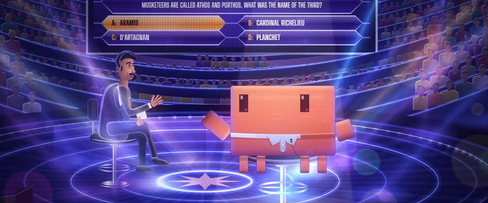

# 答题节目演播室 + 孟买橙青 · Quiz-Show Studio & Mumbai Orange-Teal

> 原文：lemo-opuscar `styleboard/opuscar98_styles.json` 第 81 条（OPUSCAR 98 纪念片里《贫民窟的百万富翁》Slumdog Millionaire（2008）那一段的风格；LemoLab，MIT，commit `413a6bd`），2026-10-27 收入本仓库作参考（不在风格库里，片子不能选它当风格），未改动。
> 这是约 5 秒片段的风格，没有完整的十一节说明，所以不进风格库。用法：当视觉语言的参考——某一段画面想要这种质感时，借它的提示词写进决策单，声音、镜头、坑由模型自己补。

**渲染**：2D（2D）　**手法组合**：电视答题节目的灯光 · 蓝紫光束与镜头光斑 · Anthony Dod Mantle 的橙青色调（TV game-show lighting · Blue-violet beams and lens flares · Anthony Dod Mantle orange and teal）

## 风格提示词（中文原文）

两种画面。主画面约占七成：光鲜的插画式答题演播室，明亮饱满，略俯的四分之三视角：底光玻璃圆台和一圈圈蓝光环，背后坐满观众，摇头灯在烟雾里打出蓝紫光束 #5A3FD0，大屏上长六角形答案框，一个锁成琥珀色 #F0A020；加泛光和横向光斑；越紧张四周越暗，最多暗到一半，不全黑。人物圆润干净，柔和明暗。第二种画面约占三成，整屏硬切：主题所在地方的黄金时刻景象，饱和橙青，密而热闹（比如铁皮屋顶、晾衣绳、人群）。点缀：洋红 #E2206B、青 #0F7C7A、橘黄 #F06A14。镜头推向大屏和座位，光束收到一人身上；其余慢摇。对标摄影师 Anthony Dod Mantle（《贫民窟的百万富翁》，2008）。避免：真实节目 logo；大片漆黑的演播室；平均打光；灰暗空荡的场景。

## Style prompt (English original)

Two registers. Primary, about 70%: a glossy illustrated quiz-show studio, bright and full, seen three-quarter from slightly above: a glass stage lit from below with concentric blue rings, a packed audience behind, moving-head beams cutting blue-violet #5A3FD0 through haze, a big screen of elongated-hexagon answers, one locked in amber #F0A020; bloom and horizontal flares; as tension rises the edges dim to about half, never black. Characters rounded, softly shaded. Second register, about 30%, as full-frame hard cuts: golden-hour views of the subject's home ground, saturated orange and teal, busy (e.g. tin roofs, washing lines, crowds). Accents: magenta #E2206B, teal #0F7C7A, tangerine #F06A14. Camera: push in on screen and hot seat as beams close on one person; elsewhere slow pans. Reference: cinematographer Anthony Dod Mantle (*Slumdog Millionaire*, 2008). Avoid: real show logos; a mostly black studio; even lighting; grey, empty places.

## 这个风格是什么（上游说明）

蓝紫色加金色高光的电视演播室，摇头灯光束、镜头光斑；然后切到饱和橙青色的孟买屋顶。影片本身就在答题节目的最后一题和贾马尔出身的贫民窟之间来回切。

A hard-lit TV studio in blue-violet with gold highlights, moving-head beams and lens flares, then a hot orange-and-teal Mumbai rooftop. The film cuts between the quiz show's final question and the slums Jamal came from.

## 上游示范用法（只是一个例子，不要照搬故事和镜头）

Clawd 扮贾马尔：浅蓝细格衬衫领加一只领夹麦。答案从第一帧就锁定；第二个镜头把全场压暗、收到热座上，答案变绿时放开；然后硬切到孟买屋顶，画面一下打开到整座城市。

| 机位 | 镜头 | Shot |
|---|---|---|
| question | 近景：大屏上的最后一题，四个答案框，A: ARAMIS 锁定成琥珀色；镜头略推。没有 Clawd。 | Close on the big screen: the final question with four answer frames, A: ARAMIS locked in amber; a slight push in. No Clawd. |
| tension | 舞台全景：主持人坐在凳子上，Clawd 扮贾马尔坐在热座上；全场暗下来，光束收拢到 Clawd 身上，接着答案闪成绿色，观众欢呼；镜头慢推。 | Wide of the stage with the host on his stool and Clawd as Jamal in the hot seat: the room darkens and the beams close in on Clawd, then the answer flashes green and the audience reacts; a slow push in. |
| mumbai | 全景：黄金时刻的达拉维屋顶，Clawd 站在铁皮屋顶上，身后高架上一列挤满人的火车开过；镜头慢慢往右摇。 | Wide of the Dharavi rooftops at golden hour: Clawd stands on a corrugated roof while a packed train passes on the viaduct behind; a slow pan right. |

参考：Danny Boyle, 2008；Anthony Dod Mantle (cinematography)；Slumdog Millionaire 2008 poster

