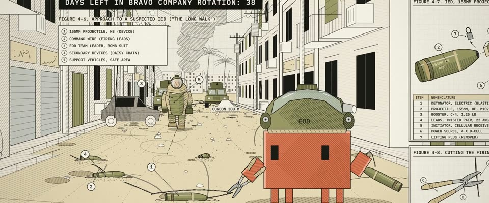

# 拆弹教范线图 · EOD Technical Manual Line Art

> 原文：lemo-opuscar `styleboard/opuscar98_styles.json` 第 82 条（OPUSCAR 98 纪念片里《拆弹部队》The Hurt Locker（2009）那一段的风格；LemoLab，MIT，commit `f171360`），2026-10-31 收入本仓库作参考（不在风格库里，片子不能选它当风格），未改动。
> 这是约 5 秒片段的风格，没有完整的十一节说明，所以不进风格库。用法：当视觉语言的参考——某一段画面想要这种质感时，借它的提示词写进决策单，声音、镜头、坑由模型自己补。

**渲染**：2D（2D）　**手法组合**：军用技术手册线图 · 爆炸分解图 · 打字机字标注 · 橄榄绿与沙色平涂（Military technical-manual line drawing · Exploded-view diagram · Typewriter callouts · Olive and sand flat tints）

## 风格提示词（中文原文）

军用技术手册插图。暖米白纸 #EFEADB 上一层很淡的工程网格，统一黑墨 #1B1A16（轮廓线宽约画面宽度的 1/700，排线更细），明暗只靠排线，地面用点刻，只在两三成的画面上平涂橄榄绿 #6C6D42 和沙色 #D9C79C；灯光画成放射线，不画光晕。主图：题材场景的一点透视画面，占页面大半，里面有人物和器物；四周是题材关键器物沿点划线轴展开的爆炸图、引线上的带圈数字、零件表、WARNING 和 CAUTION 框、打字机字体的标注（用观众的语言）和 FIG 编号，一块黑底章节卡。动画一拍二：零件滑开、工具动作、人物走路。镜头先看整页，再切到放大插图式的细节。对标美军技术手册，Kathryn Bigelow《拆弹部队》（2008）。避免：渐变明暗；颜色太多；花哨字体；空荡的页面。

## Style prompt (English original)

Military technical-manual illustration. Warm off-white paper #EFEADB with a faint engineering grid, uniform black ink #1B1A16 (outlines ~1/700 of frame width, hatching thinner), shading only by hatching, ground by stippling, flat tints of olive #6C6D42 and sand #D9C79C on 20–30% of the drawing; lights as ray lines, not glows. Main figure: a one-point-perspective view of the subject's setting filling most of the page; around it exploded views of the subject's key object along a dash-dot axis, circled numbers on leader lines, a parts table, WARNING and CAUTION boxes, typewriter labels (user's language) and FIG numbers, a black chapter card. Animate on twos: parts slide apart, a tool works, a figure walks. Camera: whole page, then cuts to enlarged insets. References: US Army technical manuals; Kathryn Bigelow, *The Hurt Locker* (2008). Avoid: gradient shading; too much colour; decorative fonts; sparse pages.

## 这个风格是什么（上游说明）

一页美军拆弹手册：均匀黑线、排线阴影、点描沙土、带圈编号和引线、IED 分解图，只有一点橄榄绿和沙色。《拆弹部队》讲高压下的程序，手册图就是画出来的程序。

A page from an army bomb-disposal manual: even black lines, hatched shadows, stippled sand, numbered callouts, an exploded IED diagram, a little olive and sand. The Hurt Locker is about procedure under pressure, and a manual page is procedure drawn.

## 上游示范用法（只是一个例子，不要照搬故事和镜头）

Clawd 戴橄榄绿拆弹头盔、面罩掀起，手拿剪线钳，站在六枚半埋的 155mm 炮弹中间。四个镜头从整页一路收紧到剪断：漫长的走路、面罩里的脸、Clawd 的眼睛、剪线。咔的一声落在这段快结束的地方。

| 机位 | 镜头 | Shot |
|---|---|---|
| still | 整页手册，FIG 4-6「THE LONG WALK」：穿拆弹服的士兵沿巴格达土路朝镜头走来，Clawd 站在串起来的炮弹中间拿着剪线钳；镜头慢慢推向街道。 | The whole manual page, FIG 4-6 'The Long Walk': a soldier in a bomb suit walks down the Baghdad street toward camera while Clawd stands over the daisy chain of shells with its cutters; a slow push toward the street. |
| suit | 近景：穿拆弹服的士兵在走，面罩里是一张皱着眉的脸；镜头慢推。 | Close on the bomb-suit soldier walking, his frowning face behind the visor; a slow push in. |
| close | 近景：戴拆弹头盔、面罩掀起的 Clawd，眼睛往下看向起爆线，剪线钳举起来；镜头略推。 | Close on Clawd in the EOD helmet with the visor up: its eyes drop to the firing lead and the cutters come up; a slight push in. |
| wire | 特写：剪线钳咬住炮弹上方的双绞起爆线，一捏、咔，线断开；镜头推近。 | Insert of the cutter jaws on the twisted firing lead above the shell: squeeze, snap, the lead parts; a push in. |

参考：Kathryn Bigelow, 2008；Barry Ackroyd (cinematography)；The Hurt Locker 2008 poster；US Army EOD technical manuals

