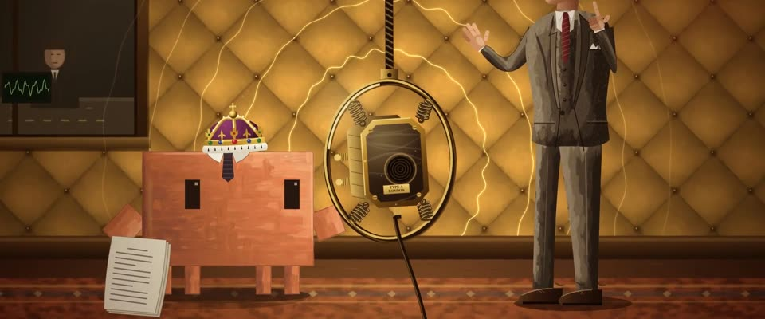

# 斑驳墙 + 金色广播间 · Peeling Wall & Gold Broadcast Booth

> 原文：lemo-opuscar `styleboard/opuscar98_styles.json` 第 83 条（OPUSCAR 98 纪念片里《国王的演讲》The King's Speech（2010）那一段的风格；LemoLab，MIT，commit `413a6bd`），2026-10-27 收入本仓库作参考（不在风格库里，片子不能选它当风格），未改动。
> 这是约 5 秒片段的风格，没有完整的十一节说明，所以不进风格库。用法：当视觉语言的参考——某一段画面想要这种质感时，借它的提示词写进决策单，声音、镜头、坑由模型自己补。

**渲染**：2D（2D）　**手法组合**：数字油画笔触 · 层层剥落的漆墙 · 30 年代广播间 · 金色声波细线（Painterly digital oil texture · Peeling layered-paint wall · 1930s broadcast booth · Gold sound-wave lines）

## 风格提示词（中文原文）

墙面就是画面的油画质感室内（户外题材搬进相关的有窗屋子）。主调：菱形钉扣软包墙，金 #C9A050 压在深褐 #3A2610 上，扣子带黄铜高光，声源（比如吊着的话筒）后面一团暖金光。副调用于安静的场景：冷灰绿墙面，局部磨穿露出蓝、粉、赭和灰泥，有潮线和细裂纹；剥落块不规则，最多占墙面三分之一。形状边缘干净，只罩一层淡淡的笔触纹理（笔触约画宽 1/120，亮度起伏 ±5%）；脸和小物件画清楚。声音画成 4–8 条细金色示波线，扩过墙面，先带尖刺，后来平滑。人物偏到角落，留大片墙。镜头慢推，插一个声源特写。对标摄影师 Danny Cohen、美术指导 Eve Stewart（《国王的演讲》，2010）。避免：居中对称；粗糙点戳笔触；地图般的剥落；霓虹般亮的声波。

## Style prompt (English original)

Painterly interiors where the wall carries the image (outdoor subjects move into a related room with a window). Primary: a diamond-tufted padded wall in gold #C9A050 over deep brown #3A2610, brass button highlights, a warm glow behind the sound source (e.g. a hanging microphone). Secondary, for quiet scenes: a cool grey-green wall worn through to blue, pink, ochre and plaster, with damp lines and fine cracks; patches irregular, under a third of the wall. Clean-edged shapes under a subtle brush texture (strokes ~1/120 of frame width, ±5% brightness); faces, small objects crisp. Sound: 4–8 thin gold oscilloscope lines crossing the wall, spiky, later smooth. Figures in a corner, lots of wall. Camera: slow push-ins, one close-up of the source. References: cinematographer Danny Cohen, designer Eve Stewart (*The King's Speech*, 2010). Avoid: centred symmetry; coarse dabbed strokes; map-like peel; neon-bright waves.

## 这个风格是什么（上游说明）

墙面肌理很重的油画质感室内：罗格诊室那面冷灰绿的多层斑驳墙，再到琥珀金的软包广播间、弹簧吊着的话筒和细细的金色声波。照着 Eve Stewart 设计的墙和海报的金黄。

Painterly interiors with heavy wall texture: Logue's peeling, many-coloured wall in cool grey-green, then a padded broadcast booth in amber gold with a sprung microphone and fine gold sound waves. It follows Eve Stewart's famous wall and the poster's gold.

## 上游示范用法（只是一个例子，不要照搬故事和镜头）

Clawd 扮乔治六世：小王冠、翼领和深色领带，诊室里夹着烟，广播间里拿着打字稿。三个镜头硬切讲完治疗：缩在角落，声波从口吃变流畅，然后罗格打着拍子，演讲播出去。

| 机位 | 镜头 | Shot |
|---|---|---|
| wall | 全景：罗格的诊室，Clawd 缩在旧皮沙发左端夹着烟，上方是大片斑驳墙，右边一台喇叭留声机；镜头慢推。 | Wide of Logue's consulting room: Clawd hunched at the left end of the old leather sofa with a cigarette, the huge peeling wall above it, a horn gramophone at right; a slow push in. |
| mic | 大特写：弹簧吊环里的大理石话筒，左边是 Clawd 的王冠和眼睛；金色声波先是断断续续（口吃），然后变得流畅；镜头慢推。 | Big close-up of the marble microphone on its sprung ring, Clawd's crown and eyes at left: the gold sound waves come out broken (the stammer), then run smooth; a slow push in. |
| still | 中全景：1939 年的广播间，Clawd 拿着讲稿在左，话筒居中，罗格在右边用手打拍子，ON AIR 灯亮起；镜头略拉。 | Medium wide of the 1939 broadcast room: Clawd with the speech at left, the microphone in the middle, Logue at right beating time with his hands as the ON AIR light comes on; a slight pull back. |

参考：Tom Hooper, 2010；Danny Cohen (cinematography)；Eve Stewart (production design)；The King's Speech 2010 poster

