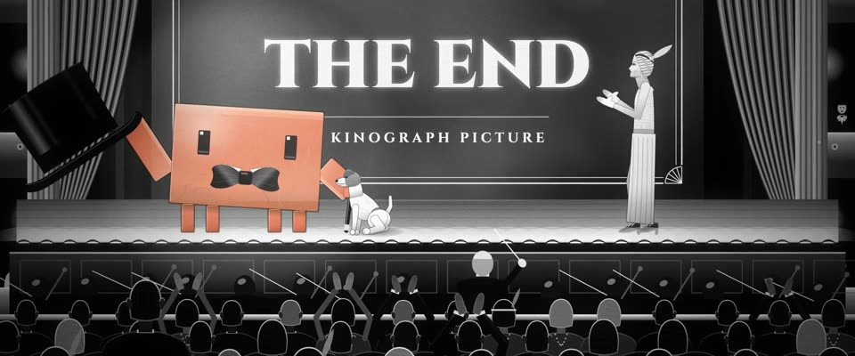

# 2011 精致默片黑白 · Polished Silent-Film Black & White

> 原文：lemo-opuscar `styleboard/opuscar98_styles.json` 第 84 条（OPUSCAR 98 纪念片里《艺术家》The Artist（2011）那一段的风格；LemoLab，MIT，commit `413a6bd`），2026-10-27 收入本仓库作参考（不在风格库里，片子不能选它当风格），未改动。
> 这是约 5 秒片段的风格，没有完整的十一节说明，所以不进风格库。用法：当视觉语言的参考——某一段画面想要这种质感时，借它的提示词写进决策单，声音、镜头、坑由模型自己补。

**渲染**：2D（2D·B&W）　**手法组合**：20 年代末默片黑白 · 装饰艺术边框字幕卡 · 好莱坞片厂的魅力布光（Late-1920s silent-film black and white · Art Deco intertitle cards · Hollywood studio glamour light）

## 风格提示词（中文原文）

致敬 20 年代末默片的现代黑白片。影调干净：发光的高光、柔和的中灰、深黑；温和的 S 曲线，灯周围有灰色光晕，轻微闪烁（±3%），细颗粒，偶有灰尘，16:9 里加 1.33 的左右黑边。字幕卡是黑底、装饰艺术风边框、字距拉开的大字，用观众的语言。场景：把题材的世界布置成宏大规整的室内或舞台布景（比如带铁艺栏杆的楼梯、金色台口、逆光剪影的人群），人物多取优雅侧面。故事围绕的那个主角是画面里唯一有颜色的东西，整个都用陶土橙 #D97757 的深浅来画；灯和火都保持灰色。镜头：平滑的推拉，字幕卡闪入，剪辑落在动作上（鞠躬、挥手）。对标摄影师 Guillaume Schiffman（《艺术家》，2011）。避免：重划痕；棕褐色调；颜色渗到灰色里。

## Style prompt (English original)

A modern homage to late-1920s silent film in black and white. Clean tones: glowing highlights, soft mid-greys, deep blacks; a gentle S-curve, grey halation around lights, slight flicker (±3%), fine grain, rare dust, a 1.33 pillarbox inside 16:9. Intertitles on black with an Art Deco border and spaced capitals, in the user's language. Settings: the subject's world staged as grand, ordered interiors or stage sets (e.g. a wrought-iron staircase, a gilt proscenium, a crowd in backlit silhouette); figures in elegant profile. The one hero subject the story centres on is the only coloured thing, wholly in tones of terracotta #D97757; lamps and fire stay grey. Camera: smooth push-ins and pull-backs, title cards flashed in, cuts landing on gestures (a bow, a wave). Reference: cinematographer Guillaume Schiffman (*The Artist*, 2011). Avoid: heavy scratches; sepia tint; colour bleeding into the greys.

## 这个风格是什么（上游说明）

干净发亮的黑白：高光明亮、灰阶柔和，装饰艺术边框的字幕卡，轻微闪烁和颗粒；Clawd 是唯一的颜色。《艺术家》是 2011 年写给默片好莱坞的情书，所以比第 1 部更精致。

Clean, glossy black and white with bright highlights and soft greys, Art Deco intertitles, light flicker and grain; Clawd is the only colour. The Artist was a 2011 love letter to silent Hollywood, so this is a sharper, cleaner silent film than No. 1.

## 上游示范用法（只是一个例子，不要照搬故事和镜头）

Clawd 扮乔治·瓦伦丁：白色翼领、黑领结、丝质高礼帽、手杖，还有杰克罗素梗 Uggie。五个快切，接近真实速度：楼梯上举帽，BANG! 字幕卡一闪，小狗倒地，最后观众起立时鞠躬。Clawd 是唯一的颜色。

| 机位 | 镜头 | Shot |
|---|---|---|
| stairs | 楼梯全景往里推：Clawd 扮乔治站在平台上，向上楼的佩皮举起高礼帽致意，群演上下交错，Uggie 在它身边。 | Wide of the Kinograph staircase, pushing in: Clawd as George on the landing lifts its top hat to Peppy on her way up, extras crossing up and down, Uggie at its side. |
| close | 近景：Clawd 举起的手摘下帽子，Uggie 仰头看它；镜头略推。 | Close on Clawd: the hat comes off in its raised hand, Uggie looking up at it; a slight push in. |
| card | 全屏字幕卡：装饰艺术边框里写着 BANG!。 | A full-screen intertitle: BANG! in an Art Deco border. |
| dog | 舞台上，Clawd 用手指比枪，Uggie 往后一倒装死；镜头慢推。 | On stage, Clawd points a finger-gun and Uggie keels over to play dead; a slow push in. |
| premiere | 首映礼全景：银幕上是 THE END，右边 Constance 在鼓掌，观众剪影站起来，Clawd 举帽拄杖鞠躬，Uggie 在脚边；镜头略拉，大幕开始合上。 | Wide of the premiere: THE END on the screen, Constance applauding at right, the house rising in silhouette as Clawd bows with its hat raised and its cane, Uggie at its feet; a slight pull back as the curtain starts to close. |

参考：Michel Hazanavicius, 2011；Guillaume Schiffman (cinematography)；The Artist 2011 poster；Bradbury Building, Los Angeles

