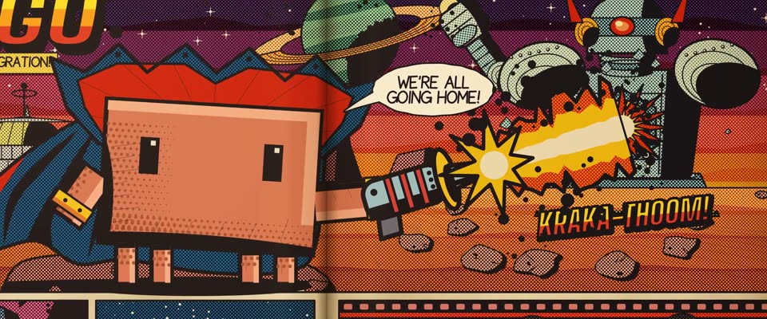

# 杰克·柯比 70 年代漫画页 · Jack Kirby 70s Comic Page

> 原文：lemo-opuscar `styleboard/opuscar98_styles.json` 第 85 条（OPUSCAR 98 纪念片里《逃离德黑兰》Argo（2012）那一段的风格；LemoLab，MIT，commit `413a6bd`），2026-10-27 收入本仓库作参考（不在风格库里，片子不能选它当风格），未改动。
> 这是约 5 秒片段的风格，没有完整的十一节说明，所以不进风格库。用法：当视觉语言的参考——某一段画面想要这种质感时，借它的提示词写进决策单，声音、镜头、坑由模型自己补。

**渲染**：2D（2D）　**手法组合**：杰克·柯比宇宙漫画 · Ben-Day 四色网点印刷 · 泛黄新闻纸 · 《光之王》概念图（Jack Kirby cosmic comics · Ben-Day four-colour print · Aged newsprint · Lord of Light concept art）

## 风格提示词（中文原文）

70 年代杰克·柯比漫画页。粗细变化的毛笔墨线，大块涂黑，透视夸张，黑色柯比能量泡，方块拟声字，手写对白框。CMYK 平涂用 45° 网点印出：青 #1696CD、品红 #DE2C70、黄 #FFD616、黑 #1C161A，泛黄新闻纸 #EEE2C2，色版错位 1 像素，纸有纤维和中缝阴影。分格叙事，镜头在格间推进、横移，推近时网点放大成波普圆点。避免：顺滑数码渐变、雪白的纸、僵硬的管状机械。

## Style prompt (English original)

1970s Jack Kirby comic page. Heavy tapered brush contours, feathered spot blacks, exaggerated perspective, Kirby Krackle energy bubbles, block sound effects, hand-lettered balloons and yellow captions. CMYK flats printed as 45° Ben-Day dots: cyan #1696CD, magenta #DE2C70, yellow #FFD616, black #1C161A on aged newsprint #EEE2C2, colour plates 1 px off register. Paper grain, browned edges, a gutter fold shadow, warm lamp falloff. Lay the story out in panels and move between them: push into the splash, pan along a strip. Dots stay round and grow into pop-art dots on push-ins. Avoid: smooth digital gradients, clean white paper, stiff tube-like machines.

## 这个风格是什么（上游说明）

摊在制片桌上的 70 年代柯比漫画：粗墨线、柯比能量泡、泛黄新闻纸上的四色网点。片中那部假科幻片用的正是柯比画的概念图，所以漫画从假史诗一路翻到真实的跑道出逃。

A 1970s Kirby comic book on a production desk: heavy ink, Kirby Krackle, Ben-Day dots on yellowed newsprint. The film's fake sci-fi movie was sold with real Kirby concept art, so the pages run from fake epic to the real runway escape.

## 上游示范用法（只是一个例子，不要照搬故事和镜头）

Clawd 扮漫画里的太空英雄：红里子高领、蓝披风、金护腕，手拿柯比式光枪。第一拍内光束开火，然后两刀硬切把书页从假史诗翻到真实出逃，最后 Clawd 卸下戏服，成了舷窗后的一名乘客。2.5 秒三格，像在读漫画。

| 机位 | 镜头 | Shot |
|---|---|---|
| splash | 宇宙跨页大格的中景，缓慢推进：披风太空英雄 Clawd 站在岩架上开光枪，光束打爆机器人的反应堆，「KRAKA-THOOM」。 | Medium shot of the cosmic splash panel, slow push-in: Clawd, the caped space hero on a rock ledge, fires its ray gun and the beam blows up the robot's reactor with a KRAKA-THOOM. |
| strip | 硬切到红色胶片条那一格：航站楼里的几位人质和旁白「THE MOVIE WAS FAKE. THE MISSION WAS REAL.」，镜头轻微右移。 | Hard cut to the red film-strip panel: the houseguests in the terminal and the caption "THE MOVIE WAS FAKE. THE MISSION WAS REAL.", with a slight pan right. |
| runway | 硬切到钢蓝色的夜间跑道格，从左往右横移，掠过追来的卡车和吉普，停在离地的客机；角上的舷窗小格里 Clawd 坐在窗后回望。 | Hard cut to the night runway panel in steel blue, panning left to right past the chasing truck and jeeps to the airliner lifting off; Clawd sits behind a porthole in the corner inset, looking back. |

参考：Ben Affleck, Argo (2012)；Jack Kirby, Lord of Light concept art (1979)；Jack Kirby, New Gods / Eternals (1970s)；Rodrigo Prieto (cinematography)

