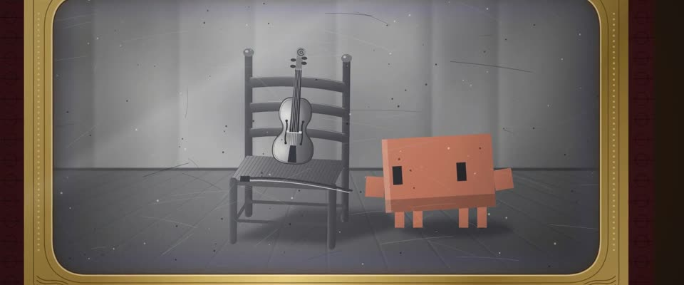

# 显影中的银版老照片 · Cased Daguerreotype, Developing

> 原文：lemo-opuscar `styleboard/opuscar98_styles.json` 第 86 条（OPUSCAR 98 纪念片里《为奴十二年》12 Years a Slave（2013）那一段的风格；LemoLab，MIT，commit `413a6bd`），2026-10-27 收入本仓库作参考（不在风格库里，片子不能选它当风格），未改动。
> 这是约 5 秒片段的风格，没有完整的十一节说明，所以不进风格库。用法：当视觉语言的参考——某一段画面想要这种质感时，借它的提示词写进决策单，声音、镜头、坑由模型自己补。

**渲染**：2D（2D·B&W）　**手法组合**：1850 年代带盒银版照片 · 手工上色锡版照片 · 影楼静物（1850s cased daguerreotype · Hand-tinted tintype · Studio still life）

## 风格提示词（中文原文）

1850 年代盒装银版照片在显影。招牌镜头：银版宽度占画面约 85%，外圈是带珠串的黄铜衬框 #8a6a2c、圆角矩形开口，红丝绒和皮盒只露在边上。银版是灰阶银色，从近黑 #1c1a18 到浅银 #ecebe6；蓝紫到琥珀的氧化晕只在开口边缘窄窄一圈。抛光旋纹、发丝划痕和斑点都要轻（亮度 ±4%）。左上方柔和窗光，主体静止摆姿，背后素色布景，户外地点画在布景上。一镜到底：前 1 秒左右镜头从打开的盒子推到招牌景别，然后停住；影像从空白的镜面灰开始，暗部先出，显影前沿从左扫到右，约 3 秒显完。只有故事围绕的那个主角手工上色：一层半透明平涂（如 #D97757），透出底下的明暗；灯保持灰色。避免：棕褐色、银版太小、快切。

## Style prompt (English original)

A cased 1850s daguerreotype, developing. Signature shot: the silver plate fills about 85% of the frame width inside a beaded brass mat #8a6a2c with a rounded-rectangle opening; velvet and leather only at the edges. Greyscale silver, near-black #1c1a18 to pale #ecebe6; a thin blue-violet to amber tarnish halo round the opening. Light swirls, hairline scratches, specks (±4% brightness). Soft window light from upper left; the subject poses still before a plain backdrop (an outdoor place is painted on it). One shot: the camera pushes from the open case to this framing in ~1 s, then holds; the image develops from blank mirror-grey, shadows first, a front sweeping left to right, done by ~3 s. Only the story's one hero is hand-tinted: a translucent flat wash (e.g. #D97757), shading showing through; lamps stay grey. Avoid: sepia, a small plate, fast cuts.

## 这个风格是什么（上游说明）

铜框丝绒盒里的 1850 年代银版照片，从空白显影：椅子上靠着小提琴，Clawd 低头站在旁边。这是所罗门·诺瑟普那个年代的照相术，只用一件物件讲这部片，不画人。

An 1850s silver-plate photograph in a brass mat and velvet case, developing from blank: a violin on a chair, Clawd beside it, head bowed. It is the photography of Solomon Northup's own time, and tells the film with one object and no people.

## 上游示范用法（只是一个例子，不要照搬故事和镜头）

没有戏服，也不画人：Clawd 站在所罗门的小提琴旁，慢慢低头。整段只有三种动：影像显影、一次慢推、低头，2.5 秒一刀不剪。

| 机位 | 镜头 | Shot |
|---|---|---|
| plate | 一镜到底：开场是桌上整只照相盒，银版一片空白；画面从一侧显影出来（小提琴靠在梯背椅上，Clawd 站在一旁），镜头慢慢推进直到银版铺满画面，Clawd 低下头。 | One continuous shot: wide on the cased plate lying on the table, blank silver; the picture develops across it (a violin leaning on a ladder-back chair, Clawd standing beside it) while the camera pushes slowly in until the plate fills the frame and Clawd lowers its head. |

参考：Steve McQueen, 12 Years a Slave (2013)；1850s cased daguerreotypes and ambrotypes；Solomon Northup, Twelve Years a Slave (1853)

