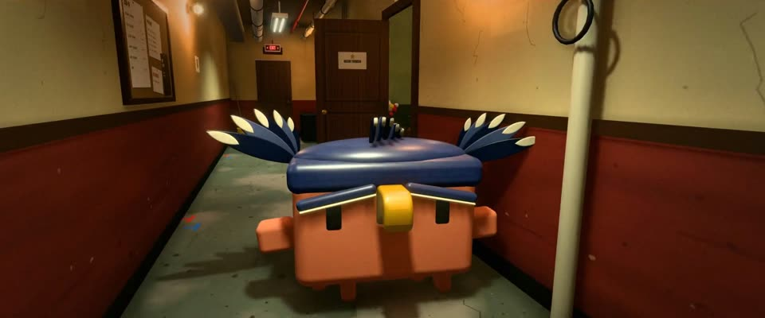

# 3D 后台走廊长镜头 · 3D Backstage Long Take

> 原文：lemo-opuscar `styleboard/opuscar98_styles.json` 第 87 条（OPUSCAR 98 纪念片里《鸟人》Birdman（2014）那一段的风格；LemoLab，MIT，commit `413a6bd`），2026-10-27 收入本仓库作参考（不在风格库里，片子不能选它当风格），未改动。
> 这是约 5 秒片段的风格，没有完整的十一节说明，所以不进风格库。用法：当视觉语言的参考——某一段画面想要这种质感时，借它的提示词写进决策单，声音、镜头、坑由模型自己补。

**渲染**：3D（3D）　**手法组合**：实时 3D（three.js） · 卢贝兹基手持长镜头 · 钨丝灯与日光灯 · 数字电影细颗粒（Real-time 3D (three.js) · Lubezki handheld long take · Tungsten and fluorescent light · Digital-cinema grain）

## 风格提示词（中文原文）

实时 3D，仿摄影师埃马努埃尔·卢贝兹基（《鸟人》，2014），一条不断的手持长镜头。主体在窄而旧的通道里（默认后台走廊；户外题材放进最近的室内）：下三分之一是掉漆的血红搪瓷墙裙 #6e2a22，上面是带水渍的烟黄石膏墙 #cdb98e，头顶水管和桥架，墙上有门和告示。光只来自画内灯具，每两三米一盏：铁笼钨丝灯（暖）、一根在闪的日光灯（冷）、一盏红色出口灯 #ff2a1a；远处门外发亮。中等曝光：灯旁墙亮，灯间不低于中灰，地面看得清。广角 18–24 毫米，低频晃动约 ±1°，柔和环境光遮蔽、轻辉光、细颗粒（±3%）。运镜 20–40 秒，次序不限：倒退领路，甩向一侧的门洞，让主体擦过镜头，再转身跟上。避免：锁死机位、空白墙面、重复纹理、压得太黑。

## Style prompt (English original)

Real-time 3D, one unbroken handheld long take, after cinematographer Emmanuel Lubezki (*Birdman*, 2014). A narrow, lived-in passage (default a backstage corridor; an outdoor subject gets its nearest interior, e.g. a stairwell): chipped blood-red enamel dado #6e2a22 on the lower third, stained nicotine plaster #cdb98e above, pipes, cable trays, doors, pinned notices. Light only from practicals every 2–3 m: warm caged tungsten bulbs, one cold flickering fluorescent tube, a red exit sign #ff2a1a; the far door glows. Mid-key: plaster light near lamps, never below mid-grey between them; floor visible. Wide lens (18–24 mm), slow sway (±1°), soft ambient occlusion, light bloom, fine grain (±3%). Over 20–40 s, in any order: lead the subject walking backwards, whip aside to a doorway, let it brush past the lens, turn and follow. Avoid: a locked-off camera, blank walls, repeated textures, a crushed dark frame.

## 这个风格是什么（上游说明）

细致的 3D 百老汇剧院后台，用手持长镜头拍：暖钨丝灯对冷日光灯，最后冲进时代广场的强光。《鸟人》最出名的就是假装一镜到底，所以这段的风格就是那条运镜。

A detailed 3D backstage of a Broadway theatre shot as a handheld long take, warm tungsten against cold fluorescent, ending in the glare of Times Square. Birdman is remembered for looking like one unbroken shot, so the style is the camera move itself.

## 上游示范用法（只是一个例子，不要照搬故事和镜头）

Clawd 扮里根，戴一顶石板蓝的鸟人头盔，金色鸟喙、两侧羽翼。走廊是一条很快的手持运镜，鼓手的摇摆鼓点就在画面里；推开后门那一下卡在拍点上，切到时代广场，Clawd 停下抬头看。

| 机位 | 镜头 | Shot |
|---|---|---|
| oner | 手持中景，镜头在戴鸟人头盔的 Clawd 前面倒退着走，向左甩到小房间里打爵士鼓的鼓手，再甩回来，Clawd 走过鼓组、擦着镜头过去。 | Handheld medium shot backing down the corridor ahead of Clawd in its Birdman helmet, whipping left to the jazz drummer in his alcove, then swinging back as Clawd passes the kit and brushes past the lens. |
| door | 切到后门，从 Clawd 背后拍，头顶是红色 EXIT 灯；镜头轻轻侧移，Clawd 一把推开门，门外一片白光。 | Cut to behind Clawd at the stage door under the red EXIT light; the camera drifts sideways as Clawd shoves the door open onto white glare. |
| times | 切到夜里的时代广场：全景，Clawd 站在人行道上，身后是成片的 LED 屏；它迈一步、抬头看屏幕，手持镜头轻轻漂移。 | Cut to Times Square at night: wide on Clawd on the sidewalk with walls of LED screens behind it; it takes a step and looks up at the screens while the handheld camera drifts slightly. |

参考：Alejandro G. Iñárritu, Birdman (2014)；Emmanuel Lubezki (cinematography)；Kevin Thompson (production design)；Antonio Sánchez (drum score)

