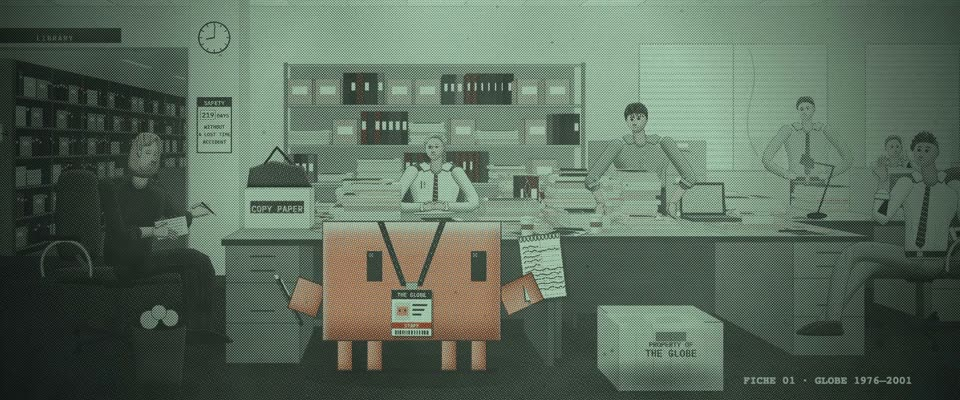

# 缩微胶片阅读机 · 报纸网点 · Microfiche Reader, Newsprint Halftone

> 原文：lemo-opuscar `styleboard/opuscar98_styles.json` 第 88 条（OPUSCAR 98 纪念片里《聚焦》Spotlight（2015）那一段的风格；LemoLab，MIT，commit `f171360`），2026-10-31 收入本仓库作参考（不在风格库里，片子不能选它当风格），未改动。
> 这是约 5 秒片段的风格，没有完整的十一节说明，所以不进风格库。用法：当视觉语言的参考——某一段画面想要这种质感时，借它的提示词写进决策单，声音、镜头、坑由模型自己补。

**渲染**：2D（2D）　**手法组合**：图书馆缩微胶片阅读机 · 2001 年报纸 CMYK 网点 · 磷光绿单色（Library microfiche reader · 2001 newspaper CMYK halftone · Phosphor-green monochrome）

## 风格提示词（中文原文）

2001 年报纸彩色网点，放在图书馆缩微胶片阅读机上看。招牌镜头：图片本身铺满画面，不要报头和文字栏；图里的线条和字（招牌、标签）保持实线。四色网点角度 15°、75°、0°、45°，网点约为画面宽度的 1/250，套色错 1 像素。整体转成低反差荧光绿单色，网点依然清楚可见：片基 #1b2320，帧间隙 #0c110f，高光不亮过 #a0dcaf。只有故事的主角整个人保留原色（如 #D97757），照样带网点，反差一样低；光源一律变绿。每 3 像素一条扫描线，每 4 秒滚过一道淡扫描带，一块柔和灯斑，玻璃上有灰和一根头发，圆角遮光罩只轻压外圈约 5%，一行小等宽胶片编号。换场把胶片横向滑过暗色帧间隙（0.5 秒）；镜头内慢推。避免：报纸版面、颜色外漏、硬切。

## Style prompt (English original)

A 2001 newspaper colour halftone on a library microfiche reader. Signature shot: the picture fills the frame, no headline or columns; lines and lettering inside it stay solid. CMYK screens at 15°, 75°, 0°, 45°, dots about 1/250 of frame width, 1 px misregistration. Convert to low-contrast phosphor-green monochrome, dots still clearly visible: film base #1b2320, frame gaps #0c110f, highlights no brighter than #a0dcaf. Only the story's one hero keeps its colour, whole figure (e.g. #D97757), screened and equally low-contrast; every light source turns green. Scan lines every 3 px, a faint scan bar every 4 s, a lamp hot-spot, dust, a hair, a light rounded hood vignette (outer ~5%), a small monospace fiche index. Scene changes slide the fiche sideways past a dark gap (0.5 s); slow push-ins. Avoid: newspaper layout, colour leaking, hard cuts.

## 这个风格是什么（上游说明）

印成报纸网点的画面，放到缩微胶片阅读机的灰绿屏幕上：扫描线、滚动的扫描光带、玻璃上的灰尘。片中记者就在这种档案里挖出真相，换镜头也做成胶片横移。

A newspaper-halftone picture seen on the green-grey screen of a library microfiche reader, with scan lines, a rolling scan bar and dust on the glass. The reporters dug the story out of archives like this, and the fiche transport replaces the cuts.

## 上游示范用法（只是一个例子，不要照搬故事和镜头）

Clawd 扮 Spotlight 小组的记者：挂绳工作证、速记本，后面换成荧光笔。三帧缩微胶片，衔接不用硬切，而是阅读机里胶片的横向滑动，最后一拍落在头版上。

| 机位 | 镜头 | Shot |
|---|---|---|
| still | 地下编辑部全景：记者围着堆满纸的桌子，头顶是荧光灯格栅，Clawd 站在前面，挂着工作证、拿着速记本；镜头慢慢拉开。 | Wide on the basement newsroom: reporters round paper-buried desks under fluorescent panels, Clawd in front with a press badge and notepad; slow pull-back. |
| list | 胶片横向滑到下一帧：俯拍打印的神父名单，玩具大小的 Clawd 推着一支大荧光笔一行行往下划，镜头跟着往下移。 | The fiche slides sideways to the next frame: top-down on a printed list of priests, a toy-sized Clawd pushing a giant highlighter down the lines while the camera drifts down. |
| headline | 再滑到印刷厂码头：中近景，Clawd 站在头版旁，标题是「Church allowed abuse by priest for years」，镜头慢推。 | Another slide to the loading dock: medium close-up of Clawd beside the front page headline "Church allowed abuse by priest for years", slow push-in. |

参考：Tom McCarthy, Spotlight (2015)；Masanobu Takayanagi (cinematography)；The Boston Globe front page, 6 January 2002；Library microfiche readers

