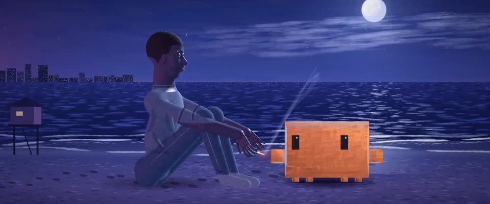

# 月光蓝调油画肖像 · Moonlight-Blue Oil Portraiture

> 原文：lemo-opuscar `styleboard/opuscar98_styles.json` 第 89 条（OPUSCAR 98 纪念片里《月光男孩》Moonlight（2016）那一段的风格；LemoLab，MIT，commit `f171360`），2026-10-31 收入本仓库作参考（不在风格库里，片子不能选它当风格），未改动。
> 这是约 5 秒片段的风格，没有完整的十一节说明，所以不进风格库。用法：当视觉语言的参考——某一段画面想要这种质感时，借它的提示词写进决策单，声音、镜头、坑由模型自己补。

**渲染**：2D（2D）　**手法组合**：油画肖像笔触 · 青绿 / 品红 / 蓝紫双色调 · 半水上半水下的机位（Oil portrait brushwork · Teal / magenta / violet duotones · Split-level waterline camera）

## 风格提示词（中文原文）

夜色油画肖像。平滑实心体积上，顺着形体用两遍短笔触重画，笔触反差小（明度 ±8%）：海、天、衣服用宽笔，约为画面宽度的 1/60；脸用细笔 1/150，保持平滑。按用途分色：天、海、远处陆地用中等明度的蓝紫 #32377a，约占画面六成；受月光的面和沙地提亮成淡薰衣草蓝；青绿 #128a91 用在水里和受光一侧；轮廓光用品红 #7a2f86；最深暗部 #07071c。任何肤色顶面都受蓝光、带湿亮高光，眼睛睁开有光。默认夜晚，唯一主光是满月，水面铺出碎光；品红只是远处光源的柔和轮廓光；其他小光源只是一小点青白光。颗粒 ±3%。招牌镜头：人物平静，约占画高三分之二。慢推。参照巴里·詹金斯《月光男孩》（2016）。避免：粗块笔触、石膏像小黑眼、发闷的近黑画面。

## Style prompt (English original)

Night oil portraiture: smooth volumes repainted in two passes of short, low-contrast (±8% value) form-following strokes: broad (1/60 of frame width) on water, sky and cloth, fine (1/150) on faces, which stay smooth. Palette by role: sky, sea and far land mid blue-violet #32377a, about 60% of the frame; moonlit planes and sand pale lavender-blue; teal #128a91 in water and lit sides; magenta #7a2f86 rim; deepest shadows #07071c. Any skin takes blue top planes and a wet highlight, eyes open and lit. Default night: one key, a full moon with a broken glitter path on water; magenta only as a soft rim from a distant glow; other small light sources stay cyan-white points. Grain ±3%. Signature shot: the figure calm, ~2/3 of frame height. Slow push-ins. Reference: Barry Jenkins, *Moonlight* (2016). Avoid: coarse dabs, small dark statue eyes, a murky frame.

## 这个风格是什么（上游说明）

饱满的青绿、品红和月光蓝油画肖像，雕出来的头像再用顺着形体的笔触重新画一遍。直接照着片名那句「月光下，黑人男孩看起来是蓝色的」来画。

Painted oil portraiture in saturated teal, magenta and moon-blue, with sculpted heads repainted in form-following strokes. It takes the film's title line, "in moonlight black boys look blue", literally.

## 上游示范用法（只是一个例子，不要照搬故事和镜头）

Clawd 扮小喀戎，不穿戏服：先在游泳课上被托在水面，再站在三张脸之间，最后坐在凯文身边的沙滩上。三个章节三个镜头硬切；海里和海滩两个镜头都慢慢推近，让安静延续下去。

| 机位 | 镜头 | Shot |
|---|---|---|
| swim | 贴着碧绿海面的半水上半水下镜头：一个男人站在齐胸深的水里，用手掌托着 Clawd，水下能看见他的手；镜头慢推。 | Split-level shot on the waterline of a turquoise Miami sea: a man stands chest-deep and holds Clawd up on his palm, his hand visible under the surface; slow push-in. |
| chapters | 切到并排的三张油画肖像，青绿、品红、蓝紫各一张；镜头重新取景，三张脸滑拼成一个楔形拼贴，Clawd 站在青绿那一块里。 | Cut to three painted portraits side by side in teal, magenta and violet; they slide into a single wedge collage as the camera reframes, with Clawd standing in the teal panel. |
| beach | 切到月光下的海滩：凯文和 Clawd 并排坐在蓝色沙滩上的双人镜头，满月在右上，浪花拍岸；镜头慢推。 | Cut to the moonlit beach: two-shot of Kevin and Clawd sitting on the blue sand, full moon upper right, surf breaking; slow push-in. |

参考：Barry Jenkins, Moonlight (2016)；James Laxton (cinematography)；Moonlight (2016) three-face poster

