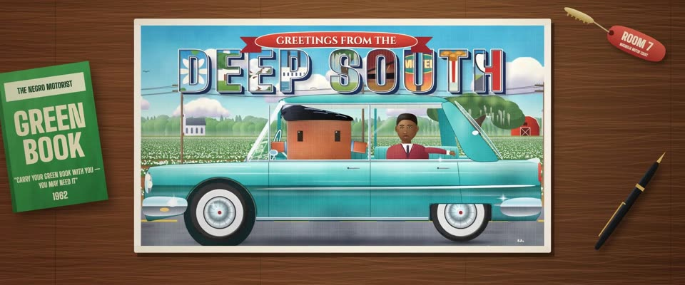

# 60 年代亚麻纹明信片 · 1960s Linen Postcard

> 原文：lemo-opuscar `styleboard/opuscar98_styles.json` 第 91 条（OPUSCAR 98 纪念片里《绿皮书》Green Book（2018）那一段的风格；LemoLab，MIT，commit `f171360`），2026-10-31 收入本仓库作参考（不在风格库里，片子不能选它当风格），未改动。
> 这是约 5 秒片段的风格，没有完整的十一节说明，所以不进风格库。用法：当视觉语言的参考——某一段画面想要这种质感时，借它的提示词写进决策单，声音、镜头、坑由模型自己补。

**渲染**：2D（2D）　**手法组合**：Curt Teich 亚麻纹明信片 · 「Greetings from」大字母 · 喷枪手工上色 · 胶印套色错位（Curt Teich linen postcard · "Greetings from" large-letter type · Airbrushed hand colouring · Offset-litho misregistration）

## 风格提示词（中文原文）

五六十年代亚麻纹明信片，柯特·泰希出版社那一路。平纹布纹卡纸：油墨只落在凸起的经纬上，形成约为画面宽度 1/300 的细格纹，凹处露白点。手工分色的饱和色，喷枪柔和过渡：天蓝 #3fa0dc、草绿 #4fae57、粉红 #f08cb0，主体物或水面用青绿 #2fb5b8，奶油卡纸 #f6e4b8 作底色和白边。主体物要大，正侧面，约占卡片高度一半。亮面加四角星闪光；套色错位 1–2 像素。藏青立体大字带白描边，横在卡片上三分之一，写地名或片名（没有就按题材编一个），每个字母里嵌一小幅风景，上方配红飘带。开场明信片放在桌上，推进到满屏后画面活过来（水在动、人在走），再侧向横移。避免：没有布纹的渐变、发灰的颜色、照片式透视。

## Style prompt (English original)

A 1950s–60s linen postcard, Curt Teich manner. Linen-weave card: ink only on raised threads, a fine crosshatch about 1/300 of frame width, white specks in the hollows. Saturated hand-separated colour, airbrush blends: sky blue #3fa0dc, grass green #4fae57, pink #f08cb0, teal #2fb5b8 for the main object or water, cream card #f6e4b8 for paper and border. The main object large, side-on, about half the card's height. Star glints on shiny surfaces; registration off 1–2 px. Big navy 3D block letters with white outlines across the top third spell the place or title (invent one if needed), a small scene in each letter, a red ribbon banner above. Open on the card on a desk, push in until it fills the frame and comes alive (water, figures move), then track sideways. Avoid: weave-less gradients, greyish colour, photographic perspective.

## 这个风格是什么（上游说明）

一张「南方问候」亚麻纹明信片活了过来：布纹纸、喷枪上的饱和色、镀铬上的星形闪光。影片是 1962 年穿越美国南方的公路旅行，走的正是这种明信片上的路。

A "Greetings from the Deep South" linen postcard that comes alive: woven paper texture, airbrushed saturated colour, chrome sparkles. The film is a 1962 road trip through the South, the same roads these cards sold to tourists.

## 上游示范用法（只是一个例子，不要照搬故事和镜头）

Clawd 扮托尼：油亮的黑色大背头、浅蓝短袖口、一支点着的烟，一手握方向盘。推进明信片的运镜直接带进公路，不切；唯一的一刀落在音乐厅，雪利博士弹琴，Clawd 在侧幕边看。

| 机位 | 镜头 | Shot |
|---|---|---|
| into | 一个连续运镜：汽车旅馆书桌上的明信片，旁边是绿皮书和房门钥匙；镜头一路推进明信片，画面活过来，青绿色凯迪拉克开动，镜头往后拉开，变成侧面跟拍，Clawd 握着方向盘，雪利博士坐在后座。 | One continuous move: the postcard on a motel desk beside a Green Book and a room key; the camera pushes into the card until the picture comes alive, the teal Cadillac pulls away and the camera pulls back into a side-on tracking shot of Clawd at the wheel with Dr. Shirley in the back. |
| piano | 唯一一刀切到音乐厅：全景，雪利博士和他的三重奏在红丝绒幕前演奏三角钢琴，Clawd 站在侧幕边看；镜头轻推。 | One cut to the concert hall: wide on Dr. Shirley at the grand piano with his trio under red velvet curtains, Clawd standing at the wing watching; slight push-in. |

参考：Peter Farrelly, Green Book (2018)；Sean Porter (cinematography)；Curt Teich & Co. linen postcards (1931–59)；The Negro Motorist Green Book (1962)

