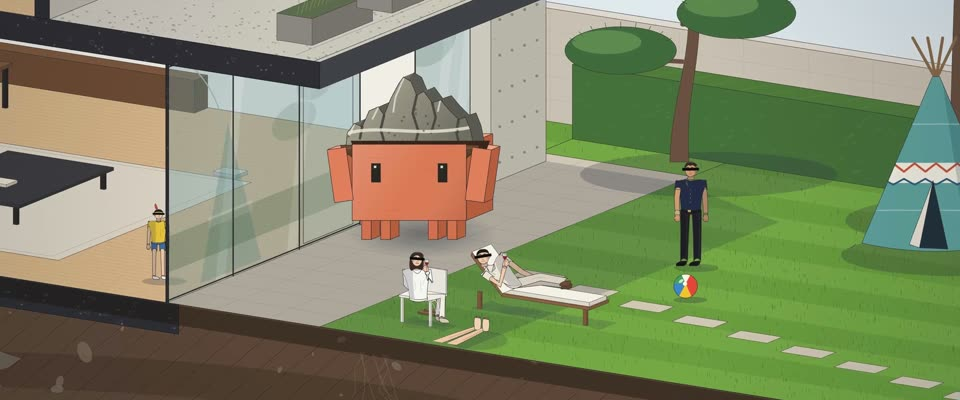

# 建筑剖面轴测图 · Architectural Section Axonometric

> 原文：lemo-opuscar `styleboard/opuscar98_styles.json` 第 92 条（OPUSCAR 98 纪念片里《寄生虫》Parasite（2019）那一段的风格；LemoLab，MIT，commit `413a6bd`），2026-10-27 收入本仓库作参考（不在风格库里，片子不能选它当风格），未改动。
> 这是约 5 秒片段的风格，没有完整的十一节说明，所以不进风格库。用法：当视觉语言的参考——某一段画面想要这种质感时，借它的提示词写进决策单，声音、镜头、坑由模型自己补。

**渲染**：2D（2D）　**手法组合**：二等角剖面轴测 · 建筑剖切填充与比例人 · 雨夜调色（Dimetric section drawing · Architectural poché and scale figures · Rainy-night colour grade）

## 风格提示词（中文原文）

矢量建筑剖面轴测图，用低角度二等角视图：剖切面沿接近水平的 7° 轴正对观众，进深沿 42° 轴、按一半缩短；屋顶和近侧墙剖掉，露出房间。剖切穿过主体所在之处（房子、塔、船、山坡）。切面填涂黑：深色混凝土带骨料，土层画 45° 斜线夹小石块。任何缩放都是 1 像素深灰线。默认白天、淡色天空：混凝土 #b3ada2、橡木 #d6b58a、炭灰 #3e4146、松绿 #3f6b3e，白墙、绿草坪、半透明蓝水。房间配家具和简洁的小比例人。夜景或其他暗光只是变体：叠乘三到四成月光蓝，亮灯的房间涂回暖色。镜头沿剖面慢慢升降，框住两三个房间，跟主体走一条不断的路线，最后停在占画面约八成的整张图上。避免：30° 等轴测、粗卡通描边、楼层间切镜头、图太小。

## Style prompt (English original)

Vector section axonometric, low dimetric view: the cut face lies along the near-flat 7° axis, facing us, depth along the 42° axis at half scale; roof and near walls cut away to show the rooms. Cut through the subject's place (a house, a tower, a ship, a hillside). Poché on cut faces: dark concrete with aggregate, earth hatched at 45° with stones. 1 px dark-grey lines at every zoom. Default daylight under a pale sky: concrete #b3ada2, oak #d6b58a, charcoal #3e4146, pine #3f6b3e, white walls, green lawn, translucent blue water. Furnished rooms, simple scale figures. Night or other low light is a variation: multiply 30–40% moonlit blue, lit rooms painted back warm. Crane slowly framing 2–3 rooms along one continuous path; end on the whole drawing at ~80% of the frame. Avoid: 30° isometric, thick outlines, cuts between levels, a small drawing.

## 这个风格是什么（上游说明）

一张剖开首尔山坡的建筑剖面图：山顶的玻璃豪宅、地下的秘密掩体、一路通到被淹的半地下室，细线、柔和的材质色。《寄生虫》建在这种上下的阶级落差上，一张图装下整部片。

One architectural section through a Seoul hillside: the glass house on top, a hidden bunker beneath, stairs down to a flooding half-basement, in fine lines and soft material colours. Parasite is built on that vertical class divide, so one drawing holds the film.

## 上游示范用法（只是一个例子，不要照搬故事和镜头）

Clawd 扮基宇，山水石一路不离手：在草坪上举过头顶，暴雨夜躲在茶几边，再一路顶着它下山。全段只切两刀；每个镜头里镜头都沿剖面上下走，让富人和穷人在同一个画面里，12 拍最后停在整张剖面上。

| 机位 | 镜头 | Shot |
|---|---|---|
| still | 白天的玻璃豪宅剖面和条纹草坪上的派对：Clawd 站在花园门口，双手把山水石举过头顶；镜头慢慢推近。 | Daytime section of the glass house and its striped lawn party: Clawd stands in the garden doorway holding the scholar's stone over its head; slow push-in. |
| house | 切到暴雨夜：朴家客厅，Clawd 躲在茶几边；镜头像升降机一样往下，穿过楼板和地下室，落到掩体，灯在按摩斯码闪。 | Cut to the stormy night: the Parks' living room with Clawd hiding by the coffee table, then the camera cranes down through the floor slab and the basement to the bunker, where the lights blink Morse. |
| descent | 切到雨中一路往下的长镜头：镜头跟着头顶山水石的 Clawd 从大门走下一段段长台阶，穿过马路底下的隧道，进到低处的街巷和正在被淹的半地下室，再升起拉开成整张剖面，豪宅在顶上，淹水在最底下。 | Cut to one continuous descent in the rain: the camera follows Clawd, the stone held over its head, from the gate down the long flights, through a tunnel under the road, into the low town and the flooding half-basement, then cranes out to the whole section, the house on top and the flood at the bottom. |

参考：Bong Joon-ho, Parasite (2019)；Hong Kyung-pyo (cinematography)；Lee Ha-jun (production design)；Parasite (2019) poster；Architectural section axonometrics

