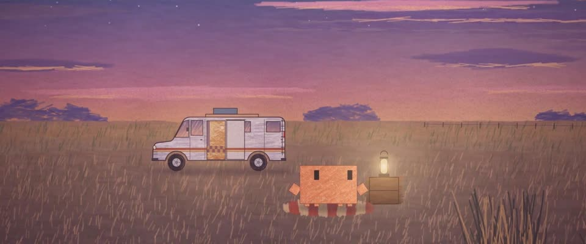

# 魔幻时刻色粉画 · Magic-Hour Soft Pastel

> 原文：lemo-opuscar `styleboard/opuscar98_styles.json` 第 93 条（OPUSCAR 98 纪念片里《无依之地》Nomadland（2020）那一段的风格；LemoLab，MIT，commit `413a6bd`），2026-10-27 收入本仓库作参考（不在风格库里，片子不能选它当风格），未改动。
> 这是约 5 秒片段的风格，没有完整的十一节说明，所以不进风格库。用法：当视觉语言的参考——某一段画面想要这种质感时，借它的提示词写进决策单，声音、镜头、坑由模型自己补。

**渲染**：2D（2D）　**手法组合**：有色纸上的软色粉 · 魔幻时刻的黄昏配色 · 纸面颗粒肌理（Soft pastel on toned paper · Magic-hour dusk palette · Paper-tooth texture）

## 风格提示词（中文原文）

灰紫色纸 #7d7079 上的软色粉画，纸的齿纹处处透出来，成细密颗粒（亮度 ±8%）。天空揉开抹平，只有几条细长的横向云带。质感集中在地面：干草赭色（金黄往纸的灰色压暗），上面铺满直立的细草笔，每笔宽约为画面宽度的 1/400、长约 1/40，明度起伏 ±15%，前景密，往地平线渐稀。物体用柔和的斜向排笔，边缘软而碎。按用途分色：地平线金黄 #f6cf7a，下层天空玫瑰 #c9738a，高空、云带和远处陆地用紫 #4b3f78，暗部用暮蓝 #2b2d5c。地平线长，在画面中线附近，下面是原野或水面；主体和身边的东西中等大小，放在下半幅。天色从金黄转玫瑰再转紫，越暗暖灯越亮。一个缓慢横移带轻推的镜头。避免：油画厚涂感、锐利数码边、光秃平滑的地面。

## Style prompt (English original)

Soft pastel on grey-violet toned paper #7d7079, tooth showing everywhere as fine speckle (±8% brightness). Sky blended smooth, a few long thin cloud bands. The land carries the texture: dry-grass ochre (gold dulled toward the paper grey) under fine upright grass strokes (1/400 of frame width wide, 1/40 long, ±15% value), dense in the foreground, thinning toward the horizon. Objects get soft diagonal hatching, broken edges. Palette by role: gold #f6cf7a at the horizon, rose #c9738a in the lower sky, violet #4b3f78 for high sky, clouds and far land, dusk blue #2b2d5c for shadows. A long horizon near mid-frame over open land or water; the subject mid-sized in the lower half. The sky drifts gold to rose to violet; lamps brighten as it darkens. One slow pan with a light push-in. Avoid: oily impasto, sharp edges, bare smooth ground.

## 这个风格是什么（上游说明）

灰紫色纸上的粉质色粉笔触，一片开阔的平原和一辆旧房车，天空从金黄变成玫瑰色再到紫色。《无依之地》就活在黄昏那条又长又空的地平线上，色粉让它安静、柔和。

Chalky soft-pastel strokes on grey-violet paper, the sky turning from gold to rose to violet over a wide plain with an old camper van. Nomadland lives in that long, empty horizon at dusk, and pastel keeps it soft and quiet.

## 上游示范用法（只是一个例子，不要照搬故事和镜头）

Clawd 扮弗恩，不拿道具，只有走、坐、看三个动作。整段一刀不剪：走路慢慢停在毯子上，坐下，再抬眼望向地平线；天色暗下来，露营灯和房车门口的光越来越暖。

| 机位 | 镜头 | Shot |
|---|---|---|
| oner | 一镜到底的全景：Clawd 从一辆侧门敞开的白色旧房车前走过，镜头跟着它横移并轻轻推近，平原和远处的孤丘缓缓滑过；它走到露营灯旁的条纹毯子上坐下，望向地平线，天色从金黄变成紫色。 | One continuous wide shot: Clawd walks in front of an old white camper van with its side door open while the camera travels with it and pushes in slightly, the plain and buttes sliding by; it reaches a striped rug by a lantern, sits down and looks out at the horizon as the sky turns from gold to violet. |

参考：Chloé Zhao, Nomadland (2020)；Joshua James Richards (cinematography)

