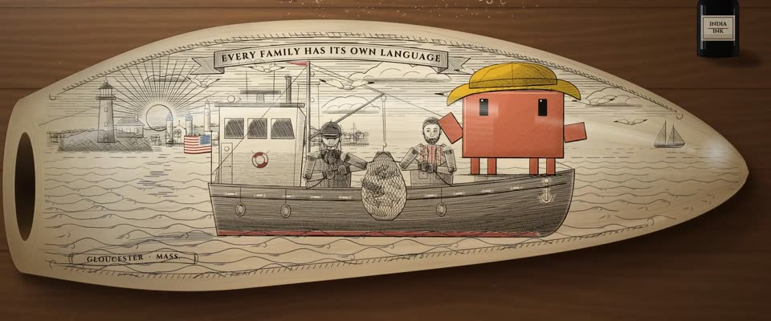

# 鲸牙骨雕（Scrimshaw） · Scrimshaw on a Whale Tooth

> 原文：lemo-opuscar `styleboard/opuscar98_styles.json` 第 94 条（OPUSCAR 98 纪念片里《健听女孩》CODA（2021）那一段的风格；LemoLab，MIT，commit `413a6bd`），2026-10-27 收入本仓库作参考（不在风格库里，片子不能选它当风格），未改动。
> 这是约 5 秒片段的风格，没有完整的十一节说明，所以不进风格库。用法：当视觉语言的参考——某一段画面想要这种质感时，借它的提示词写进决策单，声音、镜头、坑由模型自己补。

**渲染**：2D（2D）　**手法组合**：19 世纪捕鲸水手鲸骨雕 · 刻刀排线与点刻 · 桌面静物产品布光（19th-century whaler's scrimshaw · Burin hatching and stipple · Tabletop product lighting）

## 风格提示词（中文原文）

19 世纪水手在抛光鲸牙上的针刻画。招牌镜头：宽而扁的鲸牙横躺在橡木桌上，占画面宽约 85%、高约 70%，墨水瓶和折刀在边上。用近黑墨 #17110c 刻：细针排线（线宽约画面宽的 1/800，线距约 1/500）、粗细起伏的轮廓线和点刻。刻线覆盖牙面约七成：海、主体和陆地密，天空轻排线；海是成排的程式化波浪。主角要大（约占牙面高三分之一）并上色；此外红 #9a2a22、蓝 #2b4a78、黄 #e9b526 只作点缀。暖象牙底、淡生长纹、抛光划痕、牙尖蜜黄。民间朴拙构图：绳纹边框、飘带题词、放射光芒的太阳、主体世界的图案。弧度靠边缘明暗和一道窗户反光，画面不变形。先拍整颗牙，推进后慢慢横移，波浪随之动起来。避免：粗线、实色填涂、细长的牛角形。

## Style prompt (English original)

Scrimshaw: 19th-century sailor's engraving on a whale tooth. Signature shot: a broad, flat-sided tooth lies horizontal on an oak table, about 85% of frame width and 70% of its height; ink bottle, jackknife beside. Engrave in near-black #17110c: needle hatching (lines 1/800 of frame width, spaced about 1/500), swelling outlines, stipple. Lines cover ~70% of the face, dense in sea, subject and land, sky lightly hatched; seas as rows of stylised waves. The hero is large (~1/3 of the tooth's height), coloured; otherwise red #9a2a22, blue #2b4a78, yellow #e9b526 only as small touches. Warm ivory, growth bands, scratches, honey tip. Folk layout: rope border, ribbon motto, rayed sun, motifs from the subject's world. Shade the edges, one gloss streak; don't warp the picture. Push in, then pan slowly as waves animate. Avoid: thick lines, solid fills, a slim horn.

## 这个风格是什么（上游说明）

橡木桌上一颗抛光的抹香鲸牙，刻着细密的黑线，点缀红、蓝、黄：格洛斯特的渔船、收网的一家人、船头唱歌的鲁比。这是影片所在的新英格兰海岸自己的民间工艺。

A polished sperm-whale tooth on an oak table, engraved in fine black lines with touches of red, blue and yellow: a Gloucester fishing boat, the family hauling nets, Ruby singing at the bow. It is the folk art of CODA's own New England coast.

## 上游示范用法（只是一个例子，不要照搬故事和镜头）

Clawd 扮鲁比，戴一顶黄色防水渔夫帽，站在船头的鱼箱上。只有一刀：从物件切进刻画，然后一次轻轻的横移，把视线从父亲的手语带到歌声上，五线谱跟着歌声展开。

| 机位 | 镜头 | Shot |
|---|---|---|
| tooth | 全景：刻好的鲸牙放在橡木桌上，旁边是折刀和墨水瓶；镜头推进，直到鲸牙铺满画面。 | Wide on the engraved whale tooth lying on an oak table with a jackknife and an ink bottle; the camera pushes in until the tooth fills the frame. |
| boat | 切进刻画：渔船的中全景，镜头从左往右慢慢横移并轻推，从一边收网一边打出「我爱你」手语的弗兰克，移到船头唱歌的 Clawd，一行五线谱从它举起的手臂上展开。 | Cut into the engraving: medium-wide on the fishing boat, panning slowly left to right with a slight push-in, from Frank signing I-love-you while the net is hauled to Clawd singing at the bow, a stave of notes unrolling from its raised arm. |

参考：Siân Heder, CODA (2021)；CODA (2021) poster；New Bedford Whaling Museum scrimshaw collection

