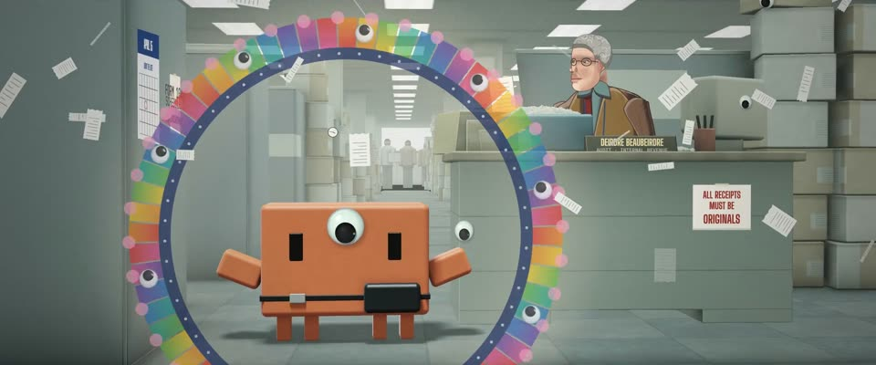

# 光线步进多元宇宙跳切 · Ray-Marched Multiverse Jump-Cuts

> 原文：lemo-opuscar `styleboard/opuscar98_styles.json` 第 95 条（OPUSCAR 98 纪念片里《瞬息全宇宙》Everything Everywhere All at Once（2022）那一段的风格；LemoLab，MIT，commit `413a6bd`），2026-10-27 收入本仓库作参考（不在风格库里，片子不能选它当风格），未改动。
> 这是约 5 秒片段的风格，没有完整的十一节说明，所以不进风格库。用法：当视觉语言的参考——某一段画面想要这种质感时，借它的提示词写进决策单，声音、镜头、坑由模型自己补。

**渲染**：3D（3D）　**手法组合**：GLSL 光线步进的多个宇宙 · 一个宇宙一种画法（写实办公室、超现实宇宙、风景、广告） · 大眼睛彩虹曼陀罗（GLSL ray-marched universes · One look per universe (office realism, cosmic surreal, landscape, commercial) · Googly-eye rainbow mandala）

## 风格提示词（中文原文）

实时光线步进 3D 的多元宇宙蒙太奇：主体在三到四个宇宙之间跳转，各有画法，都从主体自己的世界变出来，例如：冷绿日光灯下的写实工作场所，陈设很满；带引力透镜光环的超现实宇宙；配白字幕的安静旷野远景；糖果粉背景、粉青轮廓光的广告产品照。每个停 2–4 秒，各自调色。贯穿始终的衔接物：主体身上的一只活动眼贴纸，约占画高十分之一。跳转 0.5–0.8 秒：推进这只眼睛，拖影、RGB 分离，再炸开一圈彩虹色块环（#e5322d、#f7c928、#1fa39a、#2a6fc0、#e0478f），环上嵌满活动眼和粉珠，扩到画高约八成后白闪。招牌画面：彩虹环围着主体绽开；第一次跳转在 1 秒左右。参照丹尼尔斯兄弟《瞬息全宇宙》（2022）。避免：宇宙都一个样、环太小太素。

## Style prompt (English original)

Ray-marched real-time 3D multiverse montage: the subject jumps through 3–4 universes, each its own look, invented from its world, e.g. a realistic workplace under cold green fluorescents, densely dressed; a surreal cosmic version with a gravitational-lens halo; a silent wide landscape with white subtitles; a candy-pink product shot with pink-and-cyan rims. Each holds 2–4 s with its own grade. One link through all: a googly-eye sticker on the subject, about 1/10 of frame height. Transition, 0.5–0.8 s: push into the eye, smear, split RGB, then a rainbow ring of colour segments (#e5322d, #f7c928, #1fa39a, #2a6fc0, #e0478f) studded with googly eyes and pink beads blooms to ~80% of frame height and bursts to white. Signature frame: the ring around the subject; first jump at ~1 s. Reference: Daniels, *Everything Everywhere All at Once* (2022). Avoid: look-alike universes, a small plain ring.

## 这个风格是什么（上游说明）

四个宇宙四种画法，全部实时光线步进：冷绿的国税局、广告光下的热狗手指钢琴、贴大眼睛石头的寂静峡谷、变成黑洞的万物贝果。像电影里一样，靠大眼睛贴纸在宇宙间跳转。

Four universes, each with its own look, all ray-marched in real time: a cold-green IRS office, a hot-dog-finger piano lit like an advert, a silent canyon of googly-eyed rocks, the Everything Bagel as a black hole. A googly eye jumps between them.

## 上游示范用法（只是一个例子，不要照搬故事和镜头）

Clawd 扮秀莲，额头贴大眼睛、腰挂腰包。每次跳宇宙都是先推进那只眼睛，再接拖影、RGB 分离和白闪，卡在切点上；每个宇宙一个不同的动作：站着、用脚踩琴键、陪石头坐着、被吸进贝果。最后回到起点，在曼陀罗里张开双臂。

| 机位 | 镜头 | Shot |
|---|---|---|
| irs | 国税局办公室全景，收据满天飞，镜头沿过道推向 Clawd；它额头贴着一只大眼睛，腰上挂着腰包。 | Wide on the IRS office with receipts flying, the camera dollying down the aisle toward Clawd, who wears a googly eye on its forehead and a bum bag. |
| deirdre | 切到审计员和她堆满收据的钢制办公桌，她举着一张收据；镜头慢推。 | Cut to the auditor at her steel desk piled with receipts, holding one up; slow push-in. |
| eye | 切到举起双臂的 Clawd，镜头猛推进它额头的大眼睛，跳宇宙的闪光炸开。 | Cut to Clawd, arms raised, as the camera pushes hard into the googly eye on its forehead and the verse-jump flash fires. |
| hotdog | 热狗手指宇宙：糖果粉光下的亮面钢琴全景，一只手的热狗手指软软地瘫在琴键上，Clawd 站在琴键上。 | The hot-dog-finger universe: wide on a glossy piano under candy-pink light, a hand of floppy hot-dog fingers on the keys, Clawd standing on the keys. |
| hotdog | 切近到 Clawd 的脚，一下下踩着琴键，两臂末端也长出小热狗。 | Cut closer to Clawd's feet stomping the keys, little hot dogs on the ends of its arms. |
| eyeHotdog | 再次推进大眼睛，接下一次跳宇宙。 | Push into the googly eye again, and the next jump. |
| rocks | 寂静峡谷边的全景：两块贴着大眼睛的石头，Clawd 安静地坐在旁边，字幕「We're all small and stupid.」；镜头沿崖边慢慢漂移。 | Wide, still canyon rim: two rocks with googly eyes beside Clawd sitting quietly, subtitle "We're all small and stupid."; the camera drifts slowly along the edge. |
| bagel | 万物贝果：Clawd 仰望巨大的黑色贝果，镜头一路推进中间的黑洞，穿过视界，Clawd 被吸得往前倾。 | The Everything Bagel: Clawd looks up at the giant black bagel, then the camera pushes into its black-hole centre and through the event horizon as Clawd is pulled forward. |
| still | 回到办公室：Clawd 张开双臂，身后长出一圈带大眼睛的彩虹曼陀罗环；镜头轻轻拉开。 | Back in the office: Clawd flings its arms open as a rainbow mandala ring of googly eyes grows behind it; slight pull-back. |

参考：Daniels, Everything Everywhere All at Once (2022)；Larkin Seiple (cinematography)；Jason Kisvarday (production design)；Everything Everywhere All at Once (2022) poster

