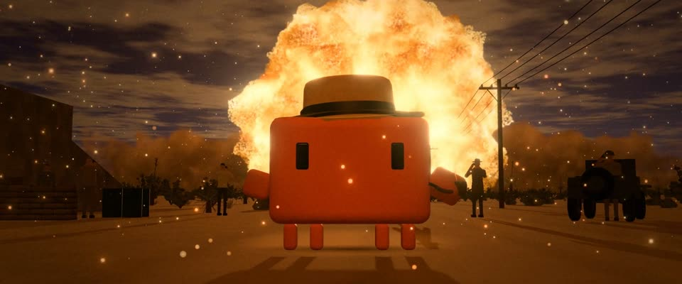

# 3D 粒子火球 · IMAX 颗粒 · 3D Particle Fireball, IMAX Grain

> 原文：lemo-opuscar `styleboard/opuscar98_styles.json` 第 96 条（OPUSCAR 98 纪念片里《奥本海默》Oppenheimer（2023）那一段的风格；LemoLab，MIT，commit `413a6bd`），2026-10-27 收入本仓库作参考（不在风格库里，片子不能选它当风格），未改动。
> 这是约 5 秒片段的风格，没有完整的十一节说明，所以不进风格库。用法：当视觉语言的参考——某一段画面想要这种质感时，借它的提示词写进决策单，声音、镜头、坑由模型自己补。

**渲染**：3D（3D）　**手法组合**：实时 3D（three.js） · GPU 粒子模拟 · IMAX 65mm 印片调色 · 三位一体试验高速照片（Real-time 3D (three.js) · GPU particle simulation · IMAX 65 mm print grade · Trinity test high-speed photographs）

## 风格提示词（中文原文）

实时 3D 夜景，主角光是一场巨大的粒子事件：几十万粒子的火球（或照明弹、火山喷发、山火），形状随时间走：白闪（0.5 秒），1 秒成翻滚的斑驳穹顶，再卷成环，尘墙外扫。在主体正后方像光环，约占画面四成：核心白金，大部分是有纹理的亮橙金火团 #ff9a50，黑烟只做细暗纹和顶边，不超一成半。火光照亮全场：暖色 #ffd8a0 铺满地面和云底，主体有热轮廓光，脸上仍有半强度暖光；长影子朝镜头拖来，火星飘飞。其余是黎明前的深蓝 #2a3654 和暗土 #16120e。只让核心过曝。IMAX 拷贝调色：细颗粒（±3%）、暖色光晕溢出、暗角、轻微片门晃动。低机位广角，主体居中，慢推。参照克里斯托弗·诺兰《奥本海默》（2023）。避免：光滑的 CG 光球、被黑烟裹住的火。

## Style prompt (English original)

Real-time 3D night lit by one huge particle event: a ~500k-particle fireball (or flare, eruption, wildfire) whose shape follows time: white flash (0.5 s), billowing dome by 1 s, a rolling toroid, a dust wall sweeping out. Right behind the subject like a halo, ~40% of the frame: white-gold core, bright orange-gold billows #ff9a50 with visible texture, black smoke only as thin veins and the top edge (under 15%). Its glow fills everything: warm #ffd8a0 on ground and cloud undersides, a hot rim on the subject, faces lit warm at half strength; long shadows toward camera. The rest is pre-dawn blue #2a3654 and dark earth #16120e. Clip only the core. IMAX grade: grain ±3%, warm halation, vignette, slight gate weave. Low wide angle, subject centred, slow push-ins. Reference: Christopher Nolan, *Oppenheimer* (2023). Avoid: a smooth CG ball, smoke-shrouded fire.

## 这个风格是什么（上游说明）

用实时 3D 重建黎明前的三位一体试验场：约 72 万粒子的火球、轨道和波组成的量子幻象，深蓝夜色对橙金火光，加 IMAX 式颗粒。《奥本海默》就围着这一道光展开。

The Trinity test site before dawn rebuilt in real-time 3D, with a fireball of about 720,000 particles, quantum visions of orbits and waves, deep pre-dawn blue against orange-gold fire and IMAX-style grain. Oppenheimer is built on that one light.

## 上游示范用法（只是一个例子，不要照搬故事和镜头）

Clawd 扮奥本海默：一顶浅驼色平顶软呢帽，手里一只冒烟的石楠烟斗。五个镜头硬切，垒出倒计时：铁塔、装置、幻象，白闪正好落在切进观察者的那一刀上；音乐不停，最后一秒火球在 Clawd 身后膨胀。

| 机位 | 镜头 | Shot |
|---|---|---|
| tower | 黎明前低机位仰拍被探照灯照亮的钢塔，倒计时的信号灯在闪，镜头慢推。 | Low-angle wide on the floodlit steel tower before dawn, the countdown beacon blinking, the camera slowly pushing in. |
| gadget | 切到波纹铁皮小屋里的炸弹：缠满电缆的螺栓球体，暖色工作灯；固定机位。 | Cut to the bomb in its corrugated shack: the bolted sphere wrapped in cables under a warm work light; locked off. |
| particles | 切到黑底上的量子幻象：围绕核心的发光轨道、下方的干涉波、一颗坍缩的恒星。 | Cut to the quantum vision on black: glowing orbits round a core, interference waves below, a star collapsing. |
| watch | 一道白闪，接反打：戴帽子的观察者举着焊接玻璃，脸被火光照亮，Clawd 戴平顶软呢帽、拿着烟斗站在中间；固定机位。 | A white flash, then the reverse shot: observers in hats hold welding glass to their eyes, lit by the fire, with Clawd in the middle in a porkpie hat and pipe; locked off. |
| still | 低机位全景：Clawd 站在路中间，身后的火球像光环一样升起，火星在空中飘；镜头慢推。 | Low-angle wide on Clawd standing in the road, the fireball rising behind it like a halo and embers drifting in the air; slow push-in. |

参考：Christopher Nolan, Oppenheimer (2023)；Hoyte van Hoytema (IMAX cinematography)；Berlyn Brixner, Trinity test photographs (1945)；Oppenheimer (2023) poster

